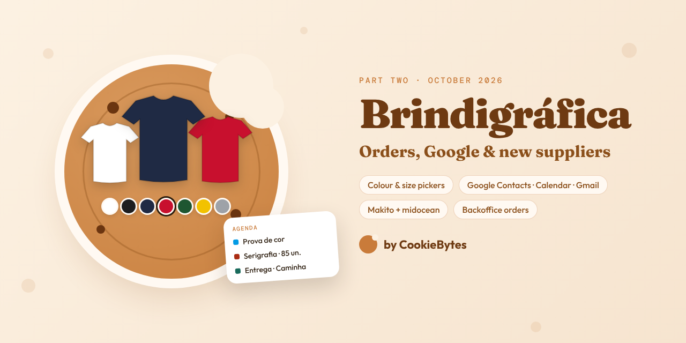
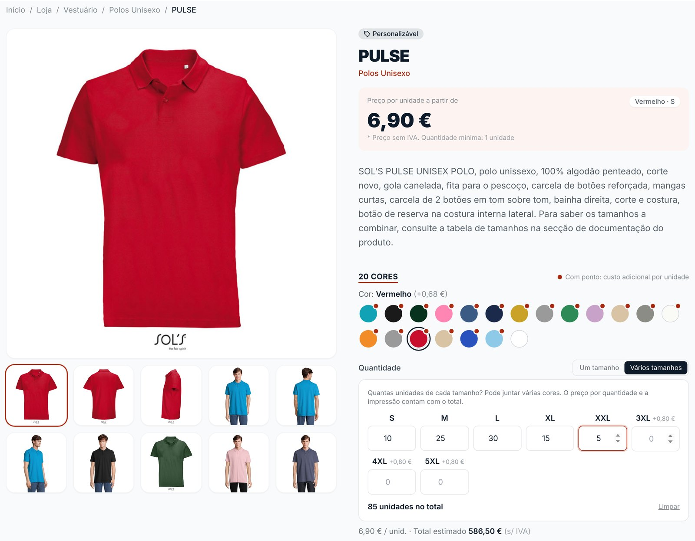
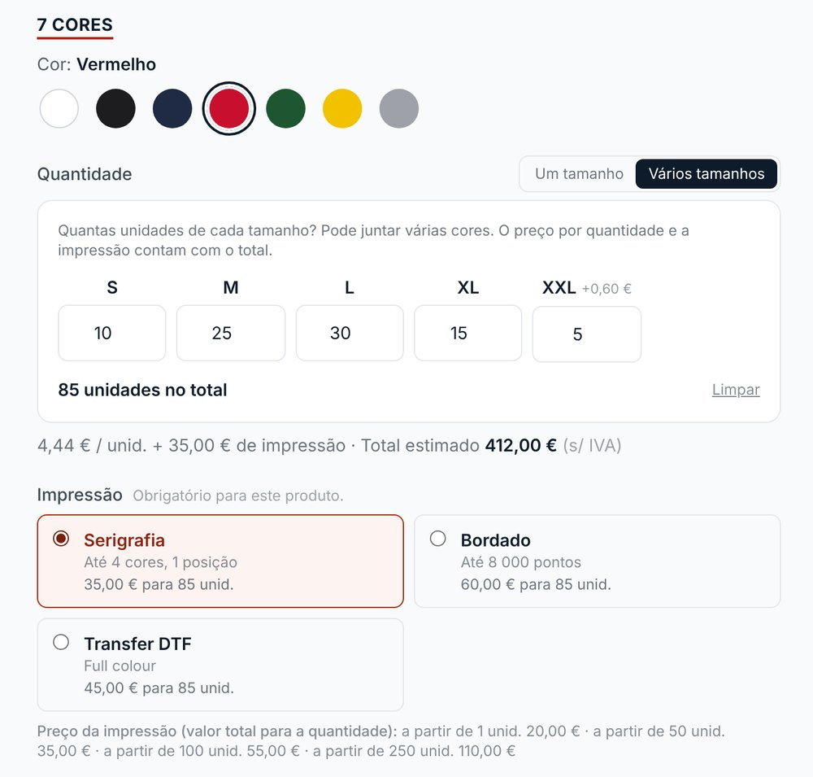
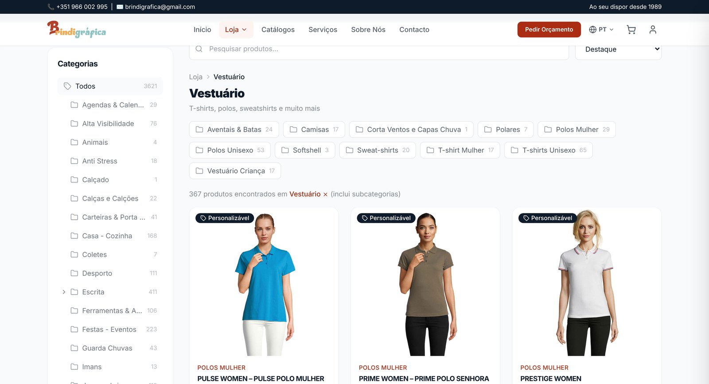
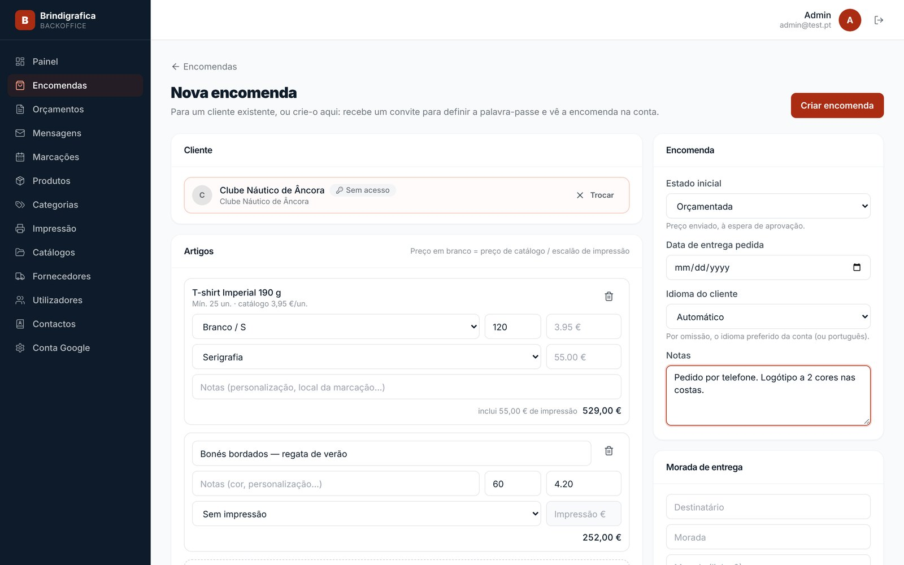
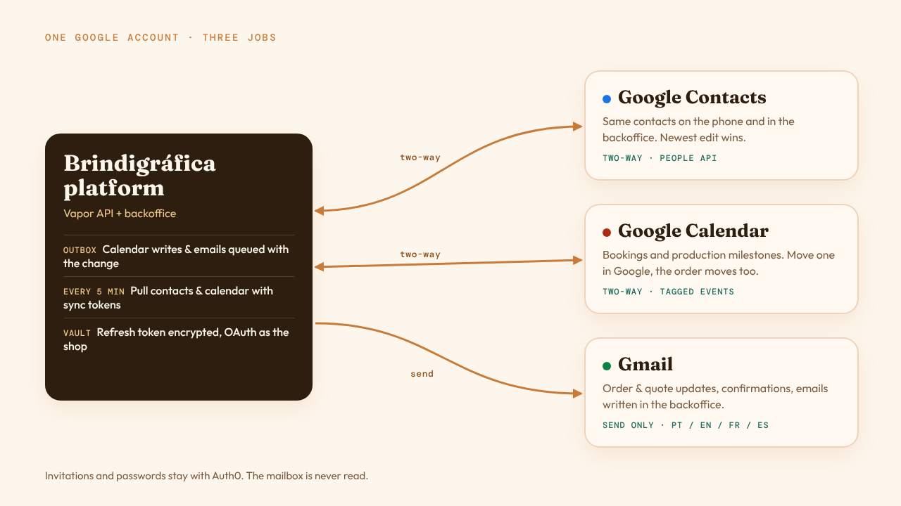
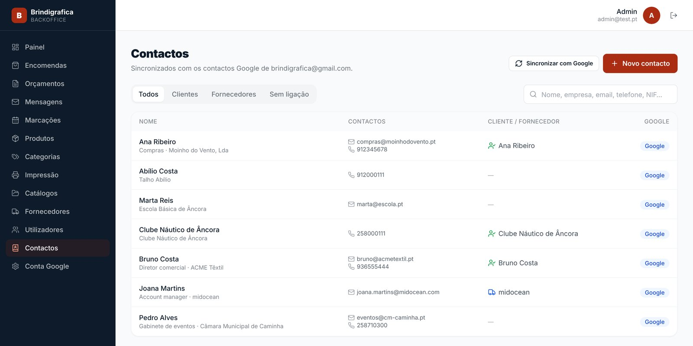
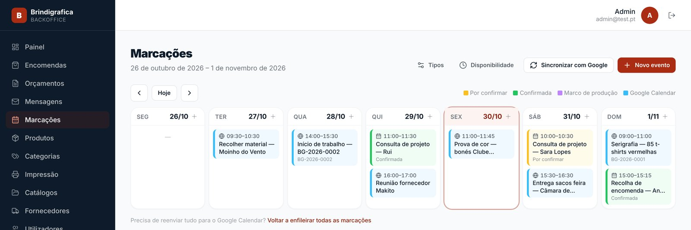
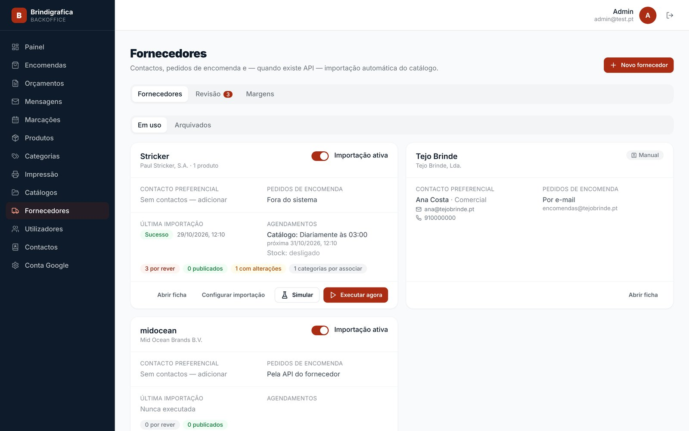

<figure>
  
</figure>

## What changed, and why

The [first post](/blog/brindigrafica-website/) ended with a roadmap: payments, calendar integration, more supplier connectors. Payments are still parked — that's deliberate. Everything else on this page came from watching the team use the platform for real:

- Customers ordering t-shirts don't buy "50 × medium black". They buy *10 S, 25 M, 30 L, 15 XL and 5 XXL, in red, with the logo printed on the back*.
- Half the orders still start with a phone call. The team needed to put those orders in themselves.
- Their address book, their agenda and their email already live in one Google account, on their phones. The platform had to join that, not compete with it.
- More of the catalogue comes from suppliers than we'd planned for.

🍪 🍪 🍪

## A product page that sells clothing the way it's bought

The product page was rebuilt around **variant pickers**. Colours are swatches, drawn from the hex code the supplier sends (or one typed in the backoffice), and each colour can carry its own photos — pick red, the gallery shows the red one. Sizes are a row, in natural order (XS before S before M, `38` before `40`), and anything else that varies — a USB stick's capacity, a pen's ink colour — becomes a row of chips. The same component handles a polo (colour × size), a mug (colour only) and a pen drive (colour × capacity).

Then there's **"Several sizes"**: a quantity box per size, so a whole team's order goes in at once — and you can switch colour and keep going, mixing colours in one go.

<figure>
  
  <figcaption>The live shop: a SOL'S polo from the midocean feed, 20 colours, 85 units across five sizes.</figcaption>
</figure>

The interesting part is the pricing. Lines of the same product **with the same printing and customisation are one job**:

- Their *combined* quantity picks the price tier — 10 S and 25 M are 35 units, not two small orders.
- The minimum order quantity is checked on the group too, so 10 S + 15 M meets a minimum of 25.
- Printing is charged once for the whole job and split across the lines by quantity, with the rounding remainder on the last line so the totals add up to the cent.

That logic lives in one pure function on the API, `LinePricing`, used by both the cart and checkout. The page shows the same number the order will have.

### Printing is part of the product

Promotional products are mostly *printing*, so printing types became a first-class thing: screen printing, embroidery, laser engraving, DTF transfer, each with its own price brackets. A bracket is the **flat cost of printing the whole line** at that quantity — 85 t-shirts with screen printing is 35 € of printing, not 85 × something. Types are offered by category (and inherited by sub-categories) or per product, and when a product offers printing, choosing one is required — the cart won't let an unprinted promotional t-shirt through by accident.

<figure style="max-width: 520px;">
  
  <figcaption>With printing types set up: the price for 85 units, printing included. (Demo data.)</figcaption>
</figure>

### Categories inside categories

The catalogue grew past a flat list. Categories can now nest up to three levels — *Clothing › Unisex polos*, *Clothing › Women's T-shirts* — products can sit at any level, and filtering a parent includes everything under it. Breadcrumbs, the header menu and the sidebar tree all come from the same parent links in the API.

<figure>
  
  <figcaption>The live catalogue: 3,621 products, and Clothing alone spans eleven sub-categories.</figcaption>
</figure>

🍪 🍪 🍪

## Orders created at the counter

The backoffice can now **create orders on a customer's behalf**: pick (or create) the customer, add catalogue lines priced like the shop would price them — or free-text lines with a typed price for the one-off job — choose the printing, set the starting status and send it.

<figure>
  
  <figcaption>A phone order going in: one catalogue line, one free-text line. (Demo data.)</figcaption>
</figure>

This one took two attempts, and the first is worth telling.

**Attempt one** let an order belong to just an email address — no account — with the customer's details copied onto the order, and a step to "claim" it later. It shipped on a Monday. By Tuesday it was clear it made everything downstream worse: two kinds of order, two places a customer's name could live, and a claiming flow nobody would remember to follow.

**Attempt two** says every order belongs to an account, full stop. If the customer doesn't have one, the backoffice creates it and Auth0 emails them a set-your-password link — so the order is already waiting on their first sign-in. A typo in that email can be fixed while the invitation is pending.

But some customers will *never* sign in. A sports club that phones twice a year doesn't want a password. So there are now **clients without a login**: a real account, with orders, quotes and history, but no Auth0 user behind it — email optional. If they ever do want access, an invite creates the login *on the same account*, and nothing moves.

The migration that took attempt one out has a guard we're quite fond of: it **refuses to run while any order has no account**, and lists which ones. You invite those customers in the old version, which moves their orders, then deploy again. A schema change that can't silently orphan data is worth a slightly awkward deploy.

🍪 🍪 🍪

## One Google account, three jobs

The shop runs on a single Google account — contacts on the phone, the agenda, the email. Rather than build a second address book, a second calendar and a mail server, the platform now plugs into that account.

<figure>
  
</figure>

**Contacts** are synced both ways. Edit a contact on the phone or in the backoffice; the newest change wins. When the platform writes back, it starts from Google's current copy, so the birthday, photo and custom fields we don't model are left alone. A contact can be linked to a client account, turned into one, or turned into a **supplier** — and contacts whose email belongs to a supplier are linked automatically.

<figure>
  
  <figcaption>The shop's Google contacts, with who's a client and who's a supplier. (Demo data.)</figcaption>
</figure>

**Calendar** is two-way too. Bookings and production milestones are written to a dedicated "Brindigráfica — Produção" calendar, and every event carries a private tag pointing back to its booking or order. Updates are PATCHes, so colours and notes someone adds in Google survive. Then the important direction: **move a milestone in Google Calendar and the order moves with it**, with a note in the order's history. The backoffice agenda also shows the rest of the account's calendar, and the team can add free-form events ("collect material", "start of work") without leaving it.

<figure>
  
  <figcaption>Bookings, production milestones and Google events in one week view. (Demo data.)</figcaption>
</figure>

**Gmail** sends the platform's email: order and quote status updates, "we got your request" confirmations (with a copy to the shop), and emails written in the backoffice. Each email is queued in the **same database transaction** as the change that caused it, so you can't get an email about an order that didn't save, or a saved order that never emails. A background loop sends them with backoff, replies about the same order stay in one Gmail thread, and the template goes out in the customer's language — Portuguese, English, French or Spanish. Every transition has an "email the customer" switch, because not every status change needs to land in someone's inbox.

### The bits that bit

- **No service account.** It's a regular Gmail account, not Google Workspace, so a service account can't act as it. The backoffice runs OAuth consent once, *as the shop*, and the API keeps the refresh token encrypted in the same vault as the supplier credentials. The scopes are deliberately narrow — `gmail.send` only; the mailbox is never read.
- **Sync tokens expire.** Google's incremental sync tokens last about a week. When one lapses, the sync falls back to a full listing and treats anything missing as deleted in Google. Getting that wrong would mean deleting contacts, so it has its own tests.
- **Stale email is worse than none.** If the account is disconnected for a few days, automatic emails older than three days are marked failed instead of sent. Nobody needs "we received your order" a week late.
- **Invitations stay on Auth0.** Account emails (set your password, verify) keep coming from Auth0, which already handles their expiry and deliverability.

🍪 🍪 🍪

## Two new suppliers, and orders that go back to them

The first post listed three connectors — Stricker, Cifra and Valento. There are now two more.

**Makito** is where Brindigráfica buys a lot of blank product and prints it themselves. Its Data API came with a PDF specification and nothing else, and we wrote the connector **before we had credentials**. So it reads leniently — it accepts the shapes the PDF describes, and the variations it hints at — and waits out rate limits instead of failing.

**midocean** was a nice surprise: SOL'S, NEOBLU and a couple of other brands Brindigráfica buys are sold through it — so SOL'S, which the first post listed as having "no integration", now has one. One connection, one supplier, the whole catalogue: the product feed comes back as a link to a single ~36 MB JSON file — 2,786 products and 21,738 variants — which the API **streams** rather than loading into memory, with English, French and Spanish texts merged in as translations. midocean doesn't send colour hex codes, so a colour typed in the backoffice is kept across syncs.

As before, nothing imported goes live by itself: it lands in a review queue, and the team publishes it.

Going the other way, the backoffice now drafts **purchase requests to suppliers** from a customer order — one per supplier, from the order's lines — and tracks them from draft to sent, confirmed and received. For midocean there's a **"Send via API"** button that places the order directly, using the variant SKUs and the shop's delivery address. It's still a person's click, and it checks it can actually send (credentials, a complete address, a SKU on every line) before offering to.

<figure>
  
  <figcaption>Each supplier is a contact card first; an API connection is optional. (Demo data.)</figcaption>
</figure>

🍪 🍪 🍪

## What's next

- **Sending as @brindigrafica.pt.** Emails currently come from the shop's Gmail address; a "Send mail as" alias will change the sender to their own domain.
- **midocean prices.** The account's price list is still being generated on midocean's side; once the first one arrives, imported products get their cost and margins kick in.
- **Online payments** — still deliberately later. Quotes and invoices remain how most of this business is done.

🍪 🍪 🍪

## The lesson, again

Every change here came from the team's day, not from the roadmap. The best feature we shipped this month was undoing one we'd shipped the day before. Launching early, with real people using it, is how you find out which model of the business is the right one.

The shop is at [brindigrafica.pt](https://brindigrafica.pt/), and the project page is [in our portfolio](/portfolio/brindigrafica/). Need a store that fits around the way your team already works? [Talk to us](/#contact).
