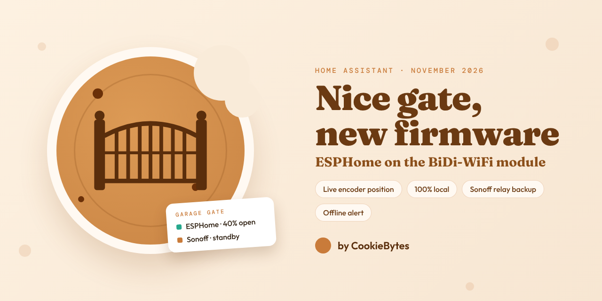
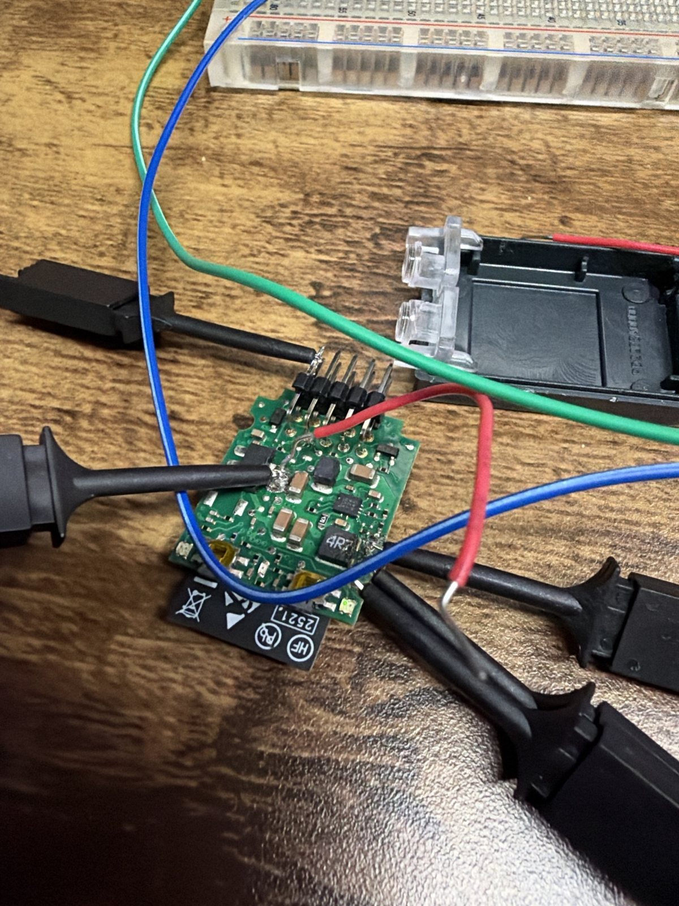
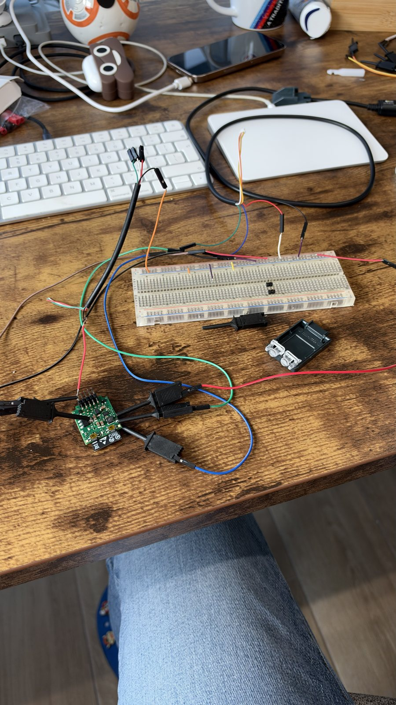

<figure>
  
</figure>

## Where we started: the Nice module, through the cloud

The motor is a Nice unit, and plugged into it sits a **BiDi-WiFi** module — the little board that puts the gate in the MyNice app. That's where this started: the gate was already "smart", so the obvious move was to connect what was there.

MyNice has an **IFTTT** service, and that was the bridge. To open the gate, Home Assistant called IFTTT, IFTTT called Nice's cloud, Nice's cloud reached the module, and the module told the motor. State came back the same way in reverse, as webhooks.

It worked on a good day. The problems were the layers:

- **Commands were slow.** Every press went through IFTTT and Nice's cloud before reaching a gate a few metres away. You'd tap "open" and wait, not knowing whether it was on its way or lost.
- **It wasn't reliable.** With that many hops, any one of them having a bad moment — the internet, IFTTT, Nice — meant the command arrived late or not at all. A gate that sometimes opens is worse than a dumb one.
- **End states only.** "Opened" and "closed", nothing in between: no position, no "stopped halfway".
- **Nothing local.** A house that needs two external services to open its own gate isn't where we wanted to be.

🍪 🍪 🍪

## The shortcut: a Sonoff relay

The fix for slow commands was the bluntest one available. A gate motor has a "step-by-step" input: short two contacts and the gate does the next thing — open, stop, close. Wire a **Sonoff relay** across it, pulse it for a second from Home Assistant, and the gate moves instantly, entirely on the local network.

That solved the speed and the reliability of commands. It didn't solve *knowing*. A relay can press the button; it can't see the gate. Used alone, Home Assistant only knows what it asked for, and that falls apart as soon as:

- someone uses the **physical remote** — Home Assistant never hears about it;
- the gate **stops halfway** on an obstacle;
- a pulse gets lost, and from then on "open" and "closed" are swapped.

And everything downstream leans on that state: the automation that closes the gate when the garage has been quiet, the "open for too long" alert, the alarm. So this is why the Sonoff was never the whole answer: fast hands, no eyes. The real state still had to come from the motor.

🍪 🍪 🍪

## Back to the module, this time locally

The module knew everything we wanted; it was the route through the cloud that was the problem. So the next step was to ask the module ourselves, over the local network.

For that we used **[homeassistant_nice](https://github.com/Jordi-14/homeassistant_nice)**, Jordi-14's custom integration for Home Assistant. It speaks the same undocumented protocol the MyNice app uses, straight to the BiDi-WiFi on the LAN. The module wants per-device credentials for that, and those live inside the app — so setup started with extracting them from a MyNice app-data backup.

It's a serious piece of work, and it got us a long way: real open/closed state with no cloud in the loop, and the encoder itself — closed at `0`, fully open at `5523`, a full run taking about 18 seconds.

Then we wanted **partial positions** — open 5% to air the garage, 75% to walk in. The stock module has no "go to 40%" command, so the integration had to do it from the outside: start the gate, poll the position twice a second, send *stop* at the right moment, and learn how far the gate coasts afterwards. The integration has a calibration routine for exactly that, and its reports are honest reading:

| Target | First try landed at | Best try |
| --- | --- | --- |
| 20% | 29% | 21.8% |
| 40% | 51% | 39% |
| 60% | 77% | 60.9% |

The good attempts were fine. The trouble was repeatability — the delay between "stop now" and the gate actually receiving it moved between 30 ms and 230 ms from one run to the next, and at 5% of travel per second that's the whole error budget. On our gate, two full calibration runs on the same morning both ended in *failed*.

Day to day it wasn't steady either: the connection to the module came and went, and with it the gate's state. None of that is the integration's fault — the code is doing the best that can be done from outside. The instability is the module itself.

### The real problem: privacy

And then there was the thing that bothered us most. Local control or not, **the module was still talking to the MyNice cloud**. The stock firmware phones home, and nothing we did in Home Assistant changed that. A device on our network that decides when the gate to the building opens was keeping a permanent line to someone else's servers — every movement reported, and a remote path to the gate that we didn't control and hadn't asked for.

So we did the obvious thing and **blocked it at the firewall**: a rule stopping the module from reaching Nice's cloud.

The gate stopped working.

With its cloud out of reach, the stock module wouldn't behave, local connection included. So "local" came with an asterisk: it only held as long as the cloud was allowed in. We could have privacy or a working gate, not both.

🍪 🍪 🍪

## The last step: replace the firmware

That settled it. As long as Nice's firmware was on that board, the cloud came with it — the only way to get **privacy** was to replace the firmware. And technically, we were on the wrong side of the module anyway. Everything we wanted was on the motor's **Bus-T4** connector — and we were asking for it through Wi-Fi, a vendor protocol and a polling loop.

The BiDi-WiFi module is, underneath, an **ESP32**. So instead of talking *to* its firmware, we replaced it with **[ESPHome](https://esphome.io/)** and **[esphome-BusT4](https://github.com/makstech/esphome-BusT4)**, makstech's open-source Bus-T4 component, so the same board speaks to the motor directly and to Home Assistant natively:

- **Position comes from the encoder, live**, read on the bus itself as the gate moves — not fetched across the network.
- **"Stop at 40%" is decided on the board**, right next to the motor, not across the network.
- **Privacy.** The board no longer talks to anyone outside the house. No MyNice cloud, no app account, no extracted credentials, no firewall rule to babysit — it's a local ESPHome device like any other here.
- It updates over the air like the rest of our ESPHome devices.

What we gave up: the MyNice app. Nobody here has missed it.

<figure style="max-width: 420px;">
  
  <figcaption>The BiDi-WiFi board out of its case, clipped up for serial flashing.</figcaption>
</figure>

### The flash

The module came out of the motor and onto the desk, following the [esphome-BusT4](https://github.com/makstech/esphome-BusT4) guide: a USB-serial adapter, a breadboard, and test clips on the board's programming pads.

**The first thing we did was read the original flash and save it** — the complete factory image, twice. If ESPHome hadn't worked out, the module could go back to being exactly what Nice shipped. Only then did the new firmware go on.

<figure style="max-width: 420px;">
  
  <figcaption>Not glamorous: a breadboard, a serial adapter and a lot of patience with clips.</figcaption>
</figure>

Back in the motor, the board found the control unit on the bus, read its limits and came up in Home Assistant as a cover with a real position — plus the motor's own *step-by-step* and *partial open* commands as buttons.

🍪 🍪 🍪

## In Home Assistant: one gate, two ways to reach it

Here's the part we care most about. The Sonoff relay never left. It's still wired to the step-by-step input, and it's now the **backup**.

Everything in the house — dashboards, automations, voice — talks to **one** gate entity. Behind it sits a small wrapper that picks the path:

- **Module online →** commands go to the ESPHome module, and state and position are the real ones from the encoder.
- **Module offline →** the same open/close/stop commands pulse the Sonoff relay instead, and the state becomes a local timer estimate (the IFTTT webhooks are long gone).

So if the module loses Wi-Fi, reboots or dies, the gate still opens from the same button. Nobody has to know which path is in use.

Three details make that switch-over clean:

- **The backup is kept up to date.** Every state change the module reports is copied into the fallback's own state. A step-by-step relay only makes sense if you know where the gate is, so when the module drops out, the fallback starts from the truth instead of a stale guess.
- **Positions degrade sensibly.** Asking for a position while on the backup becomes fully open or fully closed — the relay can't do 40%, and we'd rather it did something predictable.
- **No flicker.** For a few seconds after a command, the wrapper holds "closing" even if the module still reports "open", so the dashboard doesn't bounce.

### Is the module alive?

A silent fallback is a trap: the gate keeps working, so you'd never notice the good path was gone. So Home Assistant watches the module. If it's been unreachable for **15 minutes** (adjustable from the dashboard), we get a phone notification saying the gate is running on the Sonoff fallback and its status is estimated — and another when the module is back. The second one only fires if the first did, so a quick reboot is silent.

### What it unlocked

With a position that can be trusted, the existing automations got better without being rewritten, and two new buttons appeared:

- **Ventilate** — opens the gate to 5% to air the garage.
- **Pedestrian** — opens to 75%, enough to walk in without the full run.
- **Close when quiet** — when the camera has seen no person and no vehicle for five minutes and the gate is still open, it closes. That one now acts on the real state, remote control included.
- **Open too long** — a nudge on the phone after 30 minutes open.

The two position buttons simply grey out while the module is offline, because the backup can't do them.

🍪 🍪 🍪

## What we took from it

- **Go to the source.** Each step moved closer to the motor — cloud, then the module on the LAN, then the bus itself — and each one was faster and more reliable than the last.
- **Local isn't private until you've tried the firewall.** The integration was local; the module underneath it wasn't. Blocking its way out was the test — and the stock firmware failed it.
- **Stand on good shoulders.** Neither step would have happened without [homeassistant_nice](https://github.com/Jordi-14/homeassistant_nice) and [esphome-BusT4](https://github.com/makstech/esphome-BusT4). Thank you both.
- **Back up before you flash.** A full copy of the factory firmware turned a risky change into a reversible one.
- **Keep the dumb path.** A relay on the step-by-step input is the least smart thing in this setup, and the reason we could experiment on a gate we need every day.
- **Monitor the fallback.** A backup you don't know you're using is just a slower failure.

Got a gate, a garage door or anything else that only talks to its own app? [We do installs and integrations](/#contact) — spare key included.
