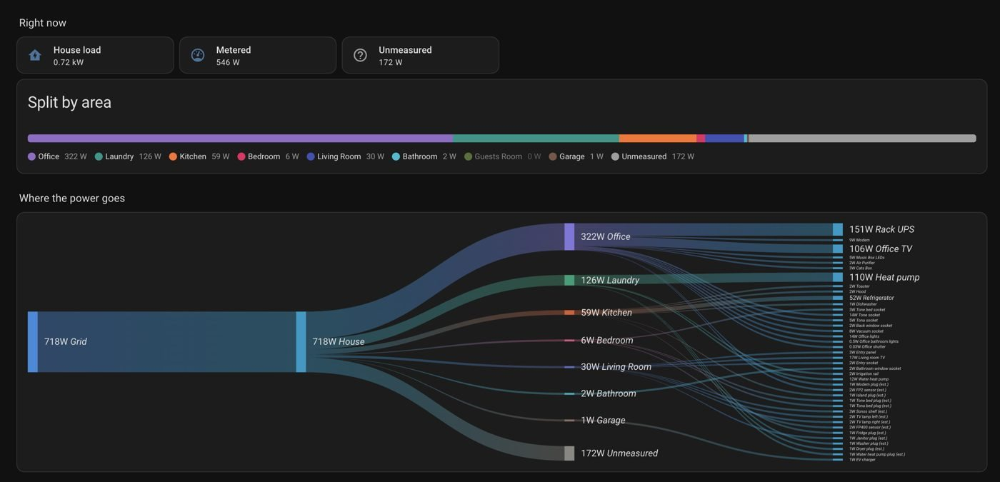
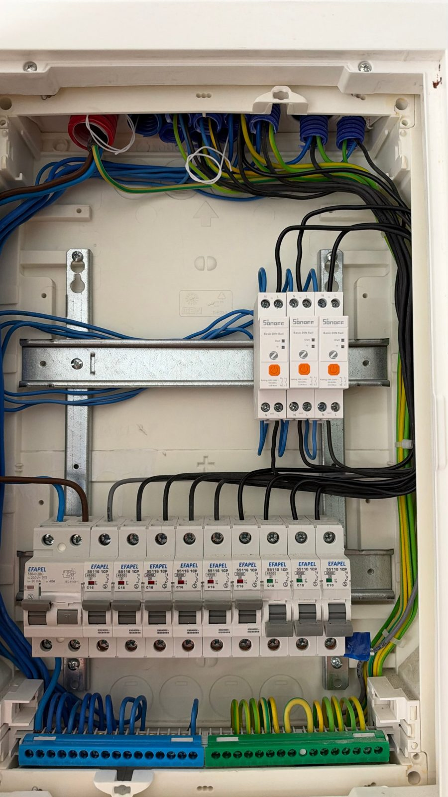
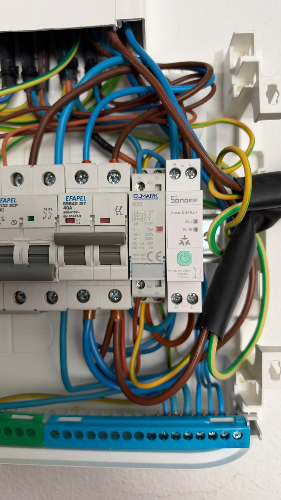

<figure>
  
  <figcaption>The Consumption view, captured on a Tuesday night: 718 W from the grid, split by room, and down to the individual device.</figcaption>
</figure>

## The problem: one big number

The house runs on a hybrid inverter with a battery and solar on the roof, and Home Assistant already knows a lot from it: what the panels make, what the battery does, what we import from or export to the grid, and the **house load** — the total of everything the house is using right now.

That number is the starting point for every question, and it's useless for the follow-up. *Why* is it 720 W at 22:40 on a quiet night? Is that the network rack? The heat pump? The TV someone forgot? Home Assistant's built-in energy dashboard can show individual devices, but only the ones you've measured — so the real work isn't the dashboard. It's the measuring.

🍪 🍪 🍪

## Three places to measure

We didn't want a single approach, because a house doesn't have a single kind of load. In the end there are three, and each fits a different job.

### 1. Relays behind the sockets

For the wall outlets we put a small **Sonoff Zigbee relay with power monitoring** behind the socket. The socket stays a normal socket — nobody has to know there's anything clever in there — but Home Assistant now sees power, current, voltage and energy for whatever is plugged into it, and can switch it off.

That's how the TVs, the toaster, the air fryer, the coffee machine, the hood and the window sockets got metered. Two details we like:

- **Protection limits are built in.** Each relay carries configurable overload thresholds; ours are set to 16 A and 3,840 W.
- **A detach mode.** The relay can be decoupled from its physical input, so the wall side and the automation side can each do their own job.

### 2. Smart plugs for the appliances that move

Not everything sits behind a fixed socket. Washing machine, tumble dryer, fridge, the water heat pump and a few others use **Sonoff Zigbee smart plugs** — same idea, but plug-in. Cheap, replaceable, and no tools.

### 3. Relays in the electrical panel

The big loads and the whole circuits are better measured at the source. In the panels we use **Sonoff DIN-rail relays** that clip onto the rail next to the breakers. Upstairs they are the Zigbee version: one in front of the office lights, one for the office bathroom lights and one for the shutter motor.

<figure style="max-width: 420px;">
  
  <figcaption>Three Zigbee DIN-rail relays above the breakers. Same relay, three circuits, three lines in the dashboard.</figcaption>
</figure>

The heat pump, the EV charger, the irrigation, the outside kitchen and the outside sockets are the other group. They use the **Wi-Fi version** of the same DIN-rail relay, and those talk **Matter** instead of Zigbee.

<figure style="max-width: 420px;">
  
  <figcaption>The Wi-Fi/Matter relay, next to a contactor. The bigger the load, the more the wiring shows who's boss.</figcaption>
</figure>

<strong>A note on safety.</strong> Panel work is mains work. The relays are the easy part; the rating, the protection and the wiring are not. Size for the load, not for the relay's maximum. We did the wiring on ours, and it's part of what we do for clients. If you're not comfortable inside a panel, don't improvise.

🍪 🍪 🍪

## What talks to what

It's a mixed house. The meters themselves speak two protocols, Zigbee and Matter, and the inverter and the UPS come in through their own integrations.

| What | How it connects | Why |
| --- | --- | --- |
| **Wall relays, plugs, the office DIN-rail relays** | **Zigbee**, through **Zigbee2MQTT** | Local, no cloud, mesh network, and mains-powered devices help carry the signal for each other |
| **Zigbee coordinators and routers** | **SMLIGHT** network-attached devices — a coordinator in the living room, routers in the office, bedroom and laundry | Zigbee coverage across floors, instead of a USB stick on a server |
| **Heat pump, EV charger, irrigation, outside kitchen, outside sockets** | **Matter over Wi-Fi** | Multi-admin: the heat pump relay is paired to Home Assistant, Apple Home and UniFi at once |
| **Inverter, battery, solar** | **FoxESS** integration, plus **Forecast.Solar** for the production forecast | Source of truth for the house total |
| **Network rack** | **Eaton UPS** integration over the UPS's network card | The rack's real output, in watts and in energy |

Zigbee does most of the work, which is the point: **lots of small meters sending small updates is exactly what a local mesh is good at**, and none of it has to leave the house. Matter covers the heat pump, the EV charger and the outdoor circuits, and the nicest thing about it so far is multi-admin: the same relay shows up in three systems at once.

🍪 🍪 🍪

## From sensors to an answer

Measuring is half of it. The other half is making the numbers add up.

1. **Per-device power and energy** come from the relays.
2. **Per-room totals** are Home Assistant group helpers that sum the power of every device in that room: Office, Laundry, Kitchen, Bedroom, Living Room, Bathroom, Guests Room and Garage.
3. **Daily energy per room** comes from utility meters on top of those totals, which reset at midnight — so "today" is always today.
4. **Nothing is counted twice.** In the energy configuration, each device is tagged as *included in* its room's total, so the Rack UPS sits inside the Office and the Office doesn't double-count it.
5. **"Unmeasured" is a number, not an apology.** It's a simple template: the house load from the inverter minus the sum of every room. Whatever isn't metered shows up as its own bar, so the dashboard can never quietly overstate how much we know.

The last piece is **powercalc**. Even a perfectly metered socket has a smart plug that uses a little power on its own, and a Sonos speaker, a presence sensor or a bedside lamp can be too small or too awkward to meter. powercalc gives us a modelled figure for those, and we mark each of them **(est.)** on the dashboard so nobody mistakes a model for a measurement.

🍪 🍪 🍪

## The dashboard

The energy dashboard has five views, and we use them for different questions:

- **Overview** — live solar, house, battery, grid and EV charger, with an animated energy-flow card at the top and the per-room split below.
- **Electricity** — Home Assistant's standard energy cards: usage, solar, sources, and a Sankey for the chosen period.
- **Now** — the last 24 hours of solar, house, battery, grid and the EV charger, plus the inverter and battery health.
- **Consumption** — the one in the picture: house, metered and unmeasured at the top, the live split by room, and a Sankey diagram from the grid, through the house and the rooms, down to individual devices.
- **Bills** — what this billing period has cost so far, the projected bill, and an **invoice check** where we type in what the utility billed and compare it to what we expect for those kilowatt-hours.

The Sankey diagram is the one everybody stops at. It's built with a custom card, and the data behind it is the same group and device sensors, and it refreshes every couple of seconds.

### What it said on a Tuesday night

When we captured the screenshot at the top, at about 22:40, the house was drawing **718 W from the grid**. **546 W of that was metered, and 172 W wasn't** — so about 76% accounted for. The split by room:

| Room | Power |
| --- | --- |
| Office | 322 W |
| Laundry | 126 W |
| Kitchen | 59 W |
| Living room | 30 W |
| Bedroom | 6 W |
| Bathroom | 2 W |
| Garage | 1 W |
| Unmeasured | 172 W |

Zoom in and the largest single line was the **Rack UPS at 151 W** — the UPS that powers the network rack — ahead of the **heat pump at 110 W** and the **office TV at 106 W**. Further down: the **fridge at 52 W**, and in the corner, the 3 W **Cats Box**.

None of that is a surprise once you see it. But we didn't know it, we guessed it, and now every one of those numbers has a history behind it.

🍪 🍪 🍪

## What we took from it

- **Measure at the source.** A relay in the wall or on the rail sees the real load. An estimate from the house total can only guess.
- **Mix protocols on purpose.** Zigbee for the many small things, Matter where a device is better that way. What matters is that it's local and that everything lands in one place.
- **Label estimates.** The most trustworthy dashboard is the one that tells you which numbers are guesses.
- **Keep the "unmeasured" bar.** That 172 W isn't a flaw — it's the list of what we still don't know, and it's where we'll keep looking.
- **Avoid double counting.** The moment you meter a room *and* the things in it, you need a clear rule for who owns the energy.
- **The wiring is part of the job.** We wired these panels ourselves. A dashboard is only as good as what sits behind the breakers, so we do both ends: the relays on the rail and the numbers on the screen.

Want to know where your own power goes? [We do the metering, the panel wiring and the dashboards](/#contact) — and we'll leave the cats alone.
