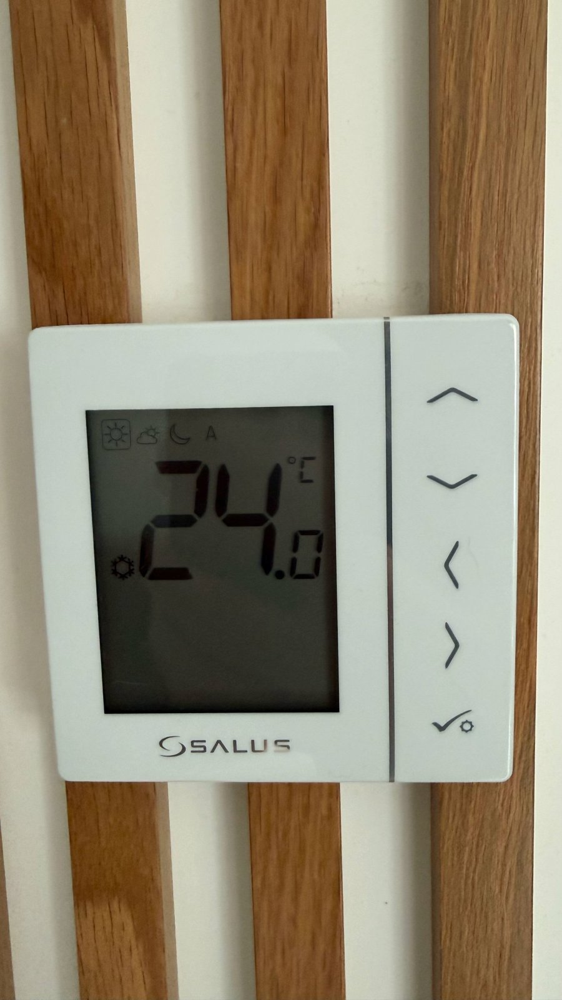
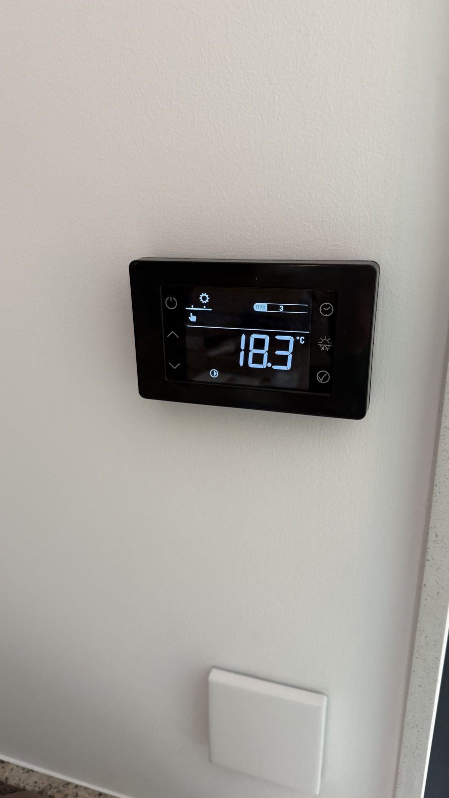
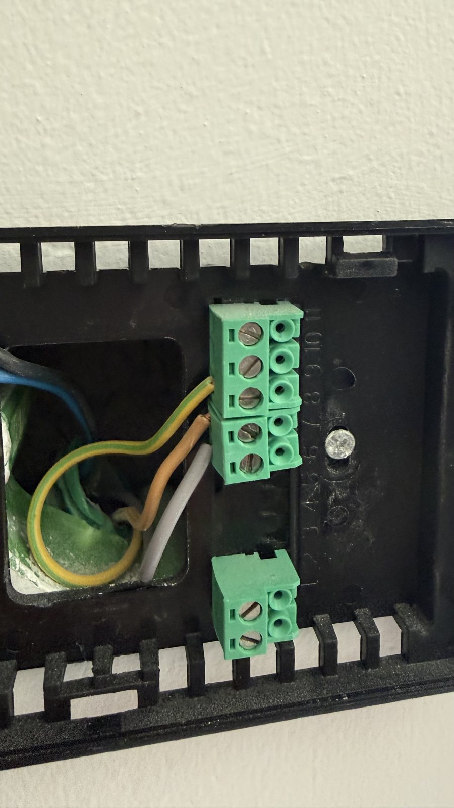
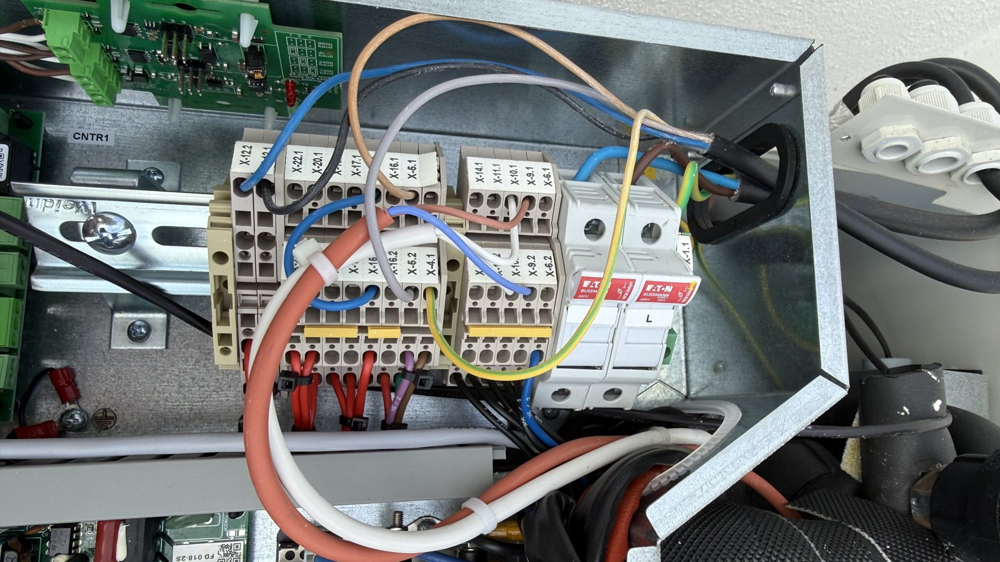
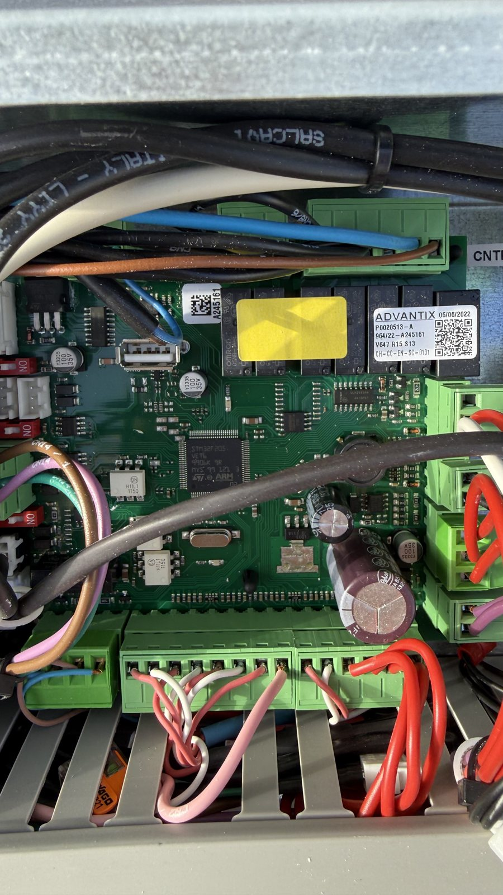
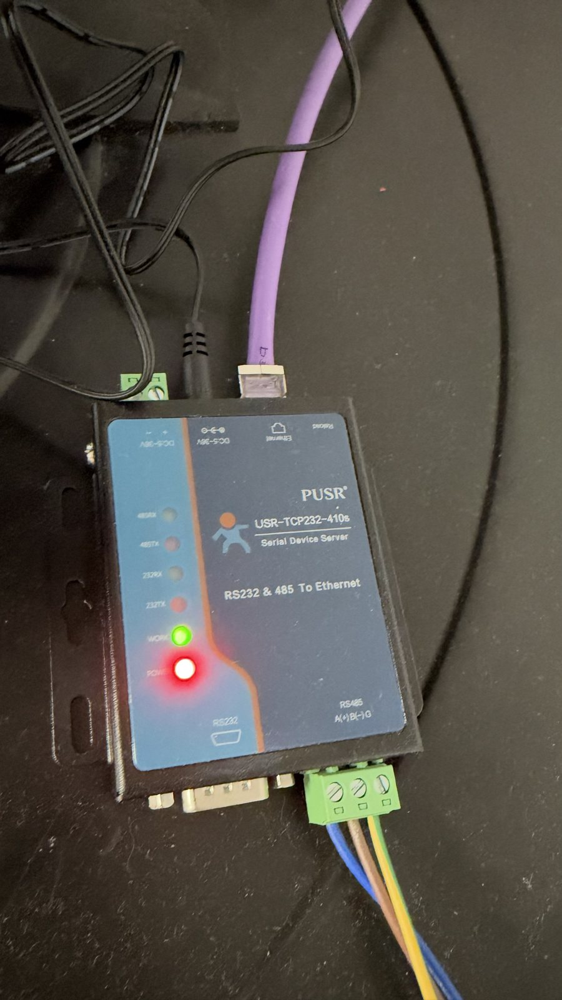
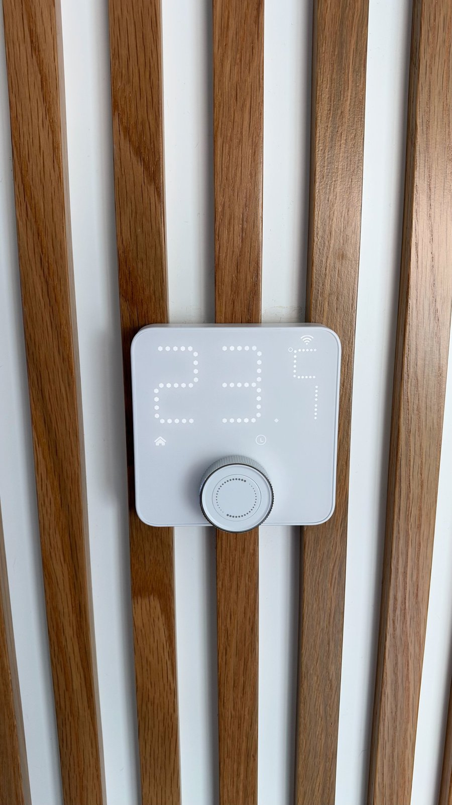
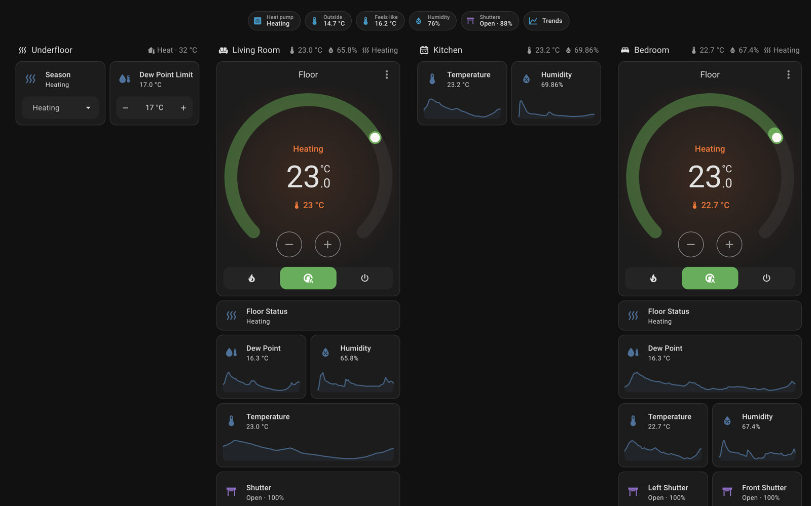
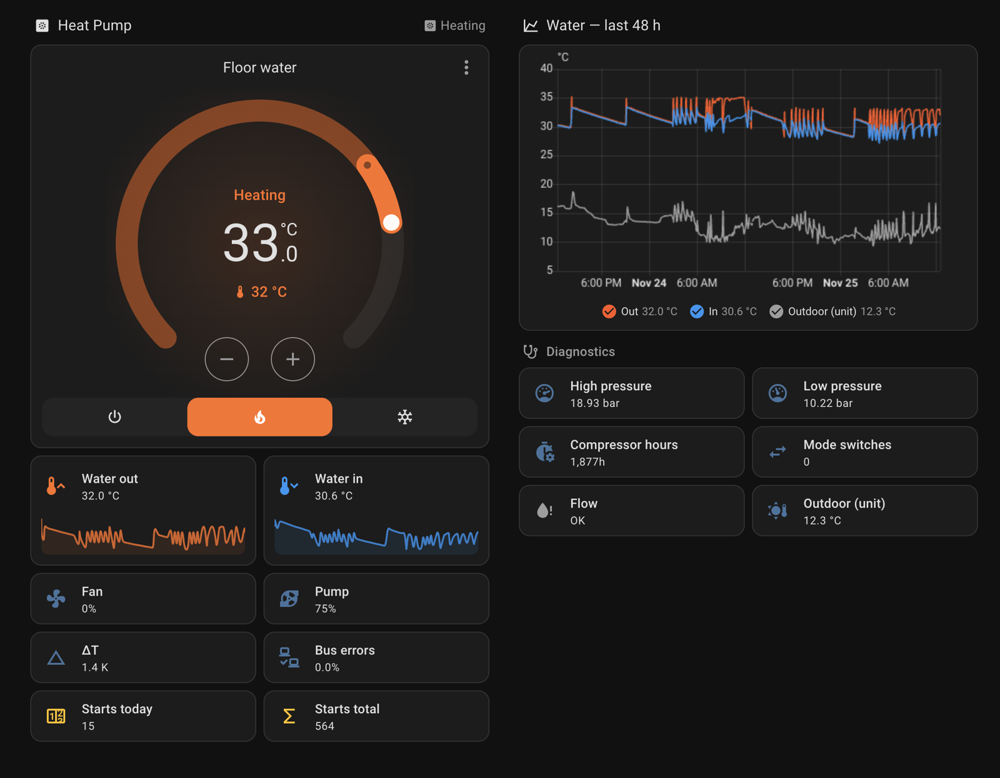
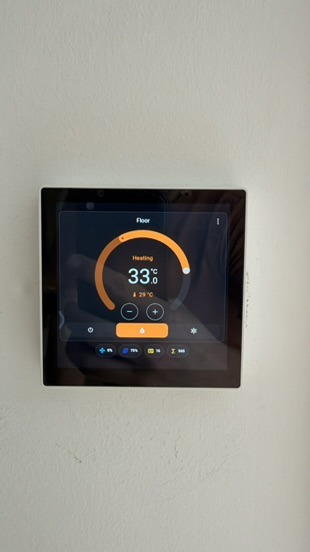

## Where we started: a climate system nobody could talk to

The setup is a common one in newer Portuguese houses:

- an **air-to-water heat pump** outside — sold as an Áurea+, which underneath is a MAXA / Advantix **i-HWAK V4** — sending warm water to the floor in winter and cool water in summer;
- a **wiring centre** that opens and closes the floor circuits;
- a **wall thermostat in each of the six zones** — living room, bedroom, bathroom, guests room, office and office bathroom — telling the wiring centre when its room wants water.

Home Assistant runs everything else in this house: shutters, lights, alarm, irrigation, the garage gate, the energy dashboard. The climate system was the hole in the middle. **We had no access to any of it:**

- **The heat pump** had no app, no API and no network connection. Its mode, its water temperature, its alarms and its history lived in the machine and in its wall control. Changing from heating to cooling meant walking up to it.
- **The thermostats** were Salus VS35W units, wired and offline. Each one switched its zone on and off and that was all. No reading the room temperature from outside, no changing a setpoint remotely, no way of knowing which zones were calling for heat.

So the biggest energy consumer in the house was also the only one we couldn't measure, schedule or coordinate with anything. The shutters knew where the sun was; the floor didn't know the shutters existed.

<figure style="max-width: 420px;">
  
  <figcaption>One of the old thermostats, a Salus VS35W. A perfectly good thermostat — and a closed box.</figcaption>
</figure>

🍪 🍪 🍪

## Part one: the heat pump, on a connection we control

### The door that was already there

The heat pump's controller speaks **Modbus over RS-485** — the standard serial bus of industrial equipment. It's how the manufacturer's own controller talks to the machine. Nothing about it is secret; it just isn't something a house normally gets to use.

<figure style="max-width: 420px;">
  
  <figcaption>The heat pump's old control. Everything went through this screen — and none of it reached Home Assistant.</figcaption>
</figure>

<figure style="max-width: 420px;">
  
  <figcaption>Behind it, once off the wall. This is the connection we replaced.</figcaption>
</figure>

So we opened the unit and went to the terminals.

<figure>
  
  <figcaption>Inside the heat pump: the terminal block where the bus leaves the machine.</figcaption>
</figure>

<figure style="max-width: 420px;">
  
  <figcaption>The controller board. Everything we wanted to know was already in here.</figcaption>
</figure>

### Our gateway

On the other end of that bus we put our own hardware: a **PUSR USR-TCP232-410s**, a small industrial serial server that turns RS-485 into Ethernet. Three wires to the bus (A, B and ground), a network cable, a power supply. Its serial side is set to match the machine — 9600 baud, 8 data bits, no parity, 1 stop bit — and its network side speaks **Modbus TCP**.

<figure style="max-width: 420px;">
  
  <figcaption>The whole "upgrade", physically: an RS-485 to Ethernet gateway on a network cable.</figcaption>
</figure>

A few choices that matter:

- **Wired, not Wi-Fi.** This is the link to the heating. It's on Ethernet, on the IoT network.
- **One master on the bus.** An RS-485 segment like this one takes a single master; two of them corrupt each other's messages. The connection that used to be the manufacturer's is now ours — Home Assistant is the one asking the questions.
- **Local only.** Modbus TCP has no password and no encryption, so the gateway is reachable from inside the house and nowhere else. No cloud, no account, no port open to the internet.

### The integration

In Home Assistant, the heat pump is handled by **[hass-maxa-advantix](https://github.com/gcoutinho-ipca/hass-maxa-advantix)**, gcoutinho-ipca's open-source integration for MAXA / Advantix heat pumps over Modbus. It polls the machine locally every 30 seconds, decodes the alarms and validates everything it writes against the manufacturer's ranges.

From a machine that used to tell us nothing, we now get:

- **A climate entity** for the floor circuit — off, heat or cool, with the water setpoint.
- **The machine state** — standby, heating, cooling — and the setpoints for heating, cooling and hot water.
- **Water in and water out**, and the difference between them.
- **Refrigerant pressures**, high and low side.
- **Condenser fan and circulator pump** speeds.
- **Outdoor temperature**, as the unit itself measures it.
- **Compressor hours.**
- **Defrost** in progress, **flow restricted**, anti-legionella status.
- **Alarms** — one "is there an alarm" sensor, one listing which ones are active, and behind them each of the machine's error codes individually, from high pressure to probe faults.
- **Bus error rate**, so we know the health of our own link.

And, for control: the mode, the setpoints, a **conditioning call** switch — the "the house wants climate" signal — and a **release control** button that hands the machine back to its own settings. That last one matters to us: taking control is something we can undo with one press.

On top of the integration we added two small things of our own. The machine doesn't report "the compressor just started", so a threshold on the condenser fan stands in for it, a counter adds up every start, and a daily statistic shows **starts today**. Short-cycling is the thing that wears a heat pump out, and now it's a number on the dashboard — an automation only counts a start that lasts more than a minute, to ignore the brief fan blips at start-up.

The feed to the heat pump also goes through a **Matter relay with power metering** in the electrical panel, so the heat pump's consumption shows up in the energy dashboard like every other circuit.

🍪 🍪 🍪

## Part two: six new thermostats

The heat pump makes the water. The thermostats decide which room gets it. Replacing one without the other would have left half the system dark, so all six thermostats came off the wall.

In their place went six **Sonoff Zigbee thermostat panels (TP-WGZBA)**, joined to the house's Zigbee network through **[Zigbee2MQTT](https://www.zigbee2mqtt.io/)**. They use the wiring that was already in the wall, and they keep doing the one job the old ones did — switch the zone — with or without Home Assistant. That was a requirement: if the server is down, the heating still works.

<figure style="max-width: 420px;">
  
  <figcaption>The new one, in the same spot. A knob for people, Zigbee for everything else.</figcaption>
</figure>

What each one brought into Home Assistant:

- **Setpoint and mode**, readable and writable.
- **Whether the zone is calling** right now.
- **A weekly schedule stored on the thermostat itself** — ours is simple: a degree warmer from 07:00 to 22:00, a degree cooler overnight. Because it lives in the device, "auto" keeps working if Zigbee or Home Assistant don't.
- **Relay behaviour** — normally open or normally closed. Remember this one; the cooling season depends on it.
- **An external temperature input**, child lock, display brightness, a night mode and a presence radar.

### The room's temperature, not the wall's

A thermostat measures the air where it's screwed to the wall — next to a door, in a hallway corner, above a socket. We already have temperature sensors placed where each room is actually lived in, so in four zones the thermostat regulates on **the room's own sensors** instead of its internal one.

That needed more care than it sounds:

- Home Assistant sends the room temperature to the thermostat **on every change**.
- The thermostat stops trusting an external value it hasn't heard for about half an hour — and in a steady room, the temperature may not change for that long. So the value is also re-sent **every five minutes** as a keep-alive, written straight to Zigbee2MQTT so it's delivered even when it's identical to the last one.
- If a thermostat does declare its external source offline, Home Assistant sends a fresh value and **re-arms** it.
- If the room sensor itself is unavailable, we do nothing — the thermostat **falls back to its own sensor**. Less accurate, never broken.

🍪 🍪 🍪

## Part three: making them work as one system

With both halves in Home Assistant, the interesting part started: the cases.

### Winter and summer: one switch for the whole house

The floor heats in winter and cools in summer. Before, changing season meant changing the heat pump and then every thermostat, one by one. Now there's a single **Season** selector — Heating or Cooling — and it follows the heat pump: put the heat pump in cool, the house goes to Cooling; put it in heat, the house goes to Heating. Turning the heat pump off doesn't change the season.

The catch is that these thermostats are **heating thermostats**. They close their relay when the room is *below* the setpoint. Cooling needs the opposite.

So when the season changes to Cooling, Home Assistant **inverts the relay** on all six thermostats, from normally open to normally closed. From then on, "room above the setpoint" is what sends water to the zone — and the water is cold.

Inverting a relay has consequences, and each one got its own guard:

- **"Off" would mean "cool forever".** With an inverted relay, a thermostat that's switched off leaves its zone open. So in the cooling season, *off* is translated into *heat at 30 °C* — a permanent demand that, inverted, means "never cool". This is applied **before** the relays are inverted at changeover, to every thermostat that happened to be off, and again any time someone turns one off during the summer.
- **Open-window detection is kept off.** In heating it would be a nice-to-have. With the relay inverted, a thermostat that reacts to an open window by cutting its demand would *start* cooling the room with the window open. If the feature gets switched on, Home Assistant switches it back off.
- **The dashboard tells the truth.** In summer a thermostat showing "heating" is in fact *not* cooling, and one showing "idle" *is*. Nobody should have to do that translation in their head, so each zone has a **Floor Status** — Heating, Cooling, Idle, Off or Blocked — that already accounts for the season.
- **Going back to Heating** returns every relay to normal.

### Summer's real danger: condensation

Cooling a floor has one failure mode that heating doesn't: if the floor surface gets colder than the **dew point** of the air above it, water condenses on it. On a wooden or tiled floor that's a slippery, damaging mess.

So every zone has a calculated dew point, from the room's temperature and humidity (Magnus formula), and a **condensation guard** watches all six, each on its own:

- If a zone's dew point stays **above the limit for five minutes**, that zone's cooling stops. Its setpoint is saved, the zone is marked **Blocked**, and the others carry on.
- When the dew point has been **at least 1 °C below the limit for ten minutes**, the zone is released and goes back to its weekly schedule. The gap between the two thresholds stops it flapping on a humid evening.
- **Every zone is re-checked when the cooling season starts**, so a room that's already humid on changeover day doesn't get a cold floor first and a check later.
- **Every block is released when the season goes back to Heating.**

The limit is 17 °C and can be changed from the dashboard, between 12 and 22 °C, without touching an automation.

### When the grid goes down: the house on batteries

The house has a FoxESS hybrid inverter with batteries. When the grid fails, the inverter carries the house on its own. That's when the heat pump stops being a comfort and becomes a problem: it's the largest load we have, and it would empty the batteries that should be keeping the fridge, the network and the lights going.

So Home Assistant sheds it:

- **The trigger is the inverter's own state** — when it reports off-grid, we're on batteries. There's also an early warning: the switchover to batteries drops mains power everywhere for about a minute, and we see that as a blip. But a blip alone never sheds anything; it only starts a six-minute wait for the inverter to confirm. No confirmation, nothing happens, and it's logged.
- **The heat pump goes to standby** over Modbus.
- **The six thermostats are switched off** — after taking a snapshot of exactly how each one was.
- **The EV charger is cut**, the other heavy load. If its relay happens to be unreachable at that moment, it's retried for up to half an hour.
- **A notification** says what was shed and how much battery there is.

And when the grid comes back:

- Nothing is restored until the grid has been **stable for ten minutes** (adjustable). Grids that fail tend to fail twice, and the reconnection itself causes another one-minute blip.
- Then the heat pump gets its mode and setpoint back, the thermostats are restored **from the snapshot**, and the charger is switched on again. A second notification confirms it.
- If Home Assistant restarted during the outage, the snapshot is gone — so the thermostats go back to **auto**, their schedule, instead of staying off.
- And if Home Assistant *starts* in the middle of an outage, it notices a shed is still active, waits for the grid and the stable period, and finishes the job. A restart can't leave the house stuck with the heating off.

### After a power cut: taking control back

This one we only found by living with it. When the heat pump loses power — or loses the gateway — it comes back on **its own local control**: the setpoint we gave it is gone and the conditioning call is off. Left alone, the house would quietly stop being heated until someone noticed.

Two automations handle it:

- **Remember.** While Home Assistant is in control, it keeps a copy of the last valid setpoint and the last mode. It ignores the brief standby the machine shows when control is taken, ignores readings that mean "the machine is on local control", and records nothing during an outage or a load shed — the forced standby must never be remembered as "the way we like it".
- **Restore.** When the machine shows up on local control for more than thirty seconds, Home Assistant writes the remembered setpoint, turns the conditioning call back on, waits for the machine to settle, and puts the mode back. It's logged, so we can see how often it happens.

The two cases are tied together on purpose: during a grid outage the restore is **held back** — we don't want the heat pump "rescued" back into heating on batteries — and it's the grid-back automation that triggers it once the grid is stable.

🍪 🍪 🍪

## What it looks like

### The Climate dashboard

One dashboard, three views.

<figure>
  
  <figcaption>Rooms: the season and the dew point limit on the left, then a column per room.</figcaption>
</figure>

**Rooms** starts with the house as a whole — heat pump state, outside temperature and humidity, shutters — and the two system-wide controls: **Season** and **Dew Point Limit**. Then every room gets a column: its thermostat, its Floor Status, dew point, temperature and humidity with a 24-hour trend, and next to them the room's shutters and its doors and windows. Climate isn't only the heating; whether the shutter is down and the window is open belongs on the same screen. Rooms without a floor zone, like the kitchen and the closet, still show their temperature and humidity.

<figure>
  
  <figcaption>Heat Pump: the machine we couldn't see into, a month later.</figcaption>
</figure>

**Heat Pump** is the machine itself: the floor-water setpoint and mode, water out and in, fan, pump, ΔT, bus errors, starts today and in total, a 48-hour graph of water and outdoor temperature, and a diagnostics block with pressures, compressor hours, mode switches and flow. Alarms appear at the top only when there is one.

**Trends** puts all rooms on the same graph for 48 hours — temperature, humidity, dew point against the limit, and shutter positions — which is where you see whether a change actually did something.

### The heat pump panel

The heat pump used to have a controller you walked up to. It still does — ours.

<figure style="max-width: 420px;">
  
  <figcaption>The panel on the wall: mode, setpoint, and whether the machine is working.</figcaption>
</figure>

A small Android wall panel runs the Home Assistant app in kiosk mode, showing a single dedicated dashboard: one big dial for the floor-water setpoint, three buttons — off, heat, cool — and a row of chips for fan, pump and compressor starts. Compressor running, defrost and alarm chips only appear when they're true. No menus, no sidebar. Anyone in the house can change season from the wall without opening an app — and because the season follows the heat pump, pressing "cool" there is what flips the six thermostats.

🍪 🍪 🍪

## What we used

- **[Home Assistant](https://www.home-assistant.io/)** — where all of it meets.
- **[hass-maxa-advantix](https://github.com/gcoutinho-ipca/hass-maxa-advantix)** by gcoutinho-ipca — the heat pump integration, over Modbus TCP.
- **PUSR USR-TCP232-410s** — the RS-485 to Ethernet gateway.
- **Sonoff TP-WGZBA** Zigbee thermostat panels, six of them.
- **[Zigbee2MQTT](https://www.zigbee2mqtt.io/)** — the thermostats' way in.
- **Matter** — the metered relay on the heat pump's feed.
- **The FoxESS integration** — the inverter state that tells us the grid is gone.
- **[Mushroom](https://github.com/piitaya/lovelace-mushroom)** and **[Kiosk Mode](https://github.com/NemesisRE/kiosk-mode)** — the chips and the clean screen on the wall panel.
- **The Home Assistant Android app** — what the wall panel runs.

Ten automations hold it together: follow the heat pump's season, apply it to the thermostats, the cooling safety guards, the condensation guard, the external temperature feed, remember and restore the heat pump's settings, count compressor starts, and the pair that sheds and restores loads.

🍪 🍪 🍪

## What we took from it

- **"No integration" often means "nobody connected it".** The heat pump had a standard industrial bus on its terminals the whole time. The upgrade was a gateway and a cable.
- **Replace both halves.** A visible heat pump with blind thermostats — or the reverse — can't do a seasonal changeover or a load shed. The value was in the two talking to each other.
- **Keep the dumb path working.** The thermostats still switch their zones with Home Assistant off, the schedule lives in the device, a thermostat without its external sensor uses its own, and the heat pump can be handed back to its own settings with one button.
- **Cooling with heating thermostats works — with guards.** Inverting a relay is one line. Making "off", "open window" and "idle" still mean the right thing took three more.
- **Design for the bad day.** Most of the automation here isn't about comfort. It's about a power cut at 3 a.m., a restart in the middle of an outage, and a machine that forgets what it was told.
- **Stand on good shoulders.** None of the heat pump side would exist without [hass-maxa-advantix](https://github.com/gcoutinho-ipca/hass-maxa-advantix). Thank you.

One honest note: connecting your own control to a heat pump can affect its warranty, and what's safe to write to it depends on the machine. Ask before you open one.

Have a heat pump, an underfloor system or a set of thermostats that only answer to themselves? [We do installs and integrations](/#contact) — wiring included.
