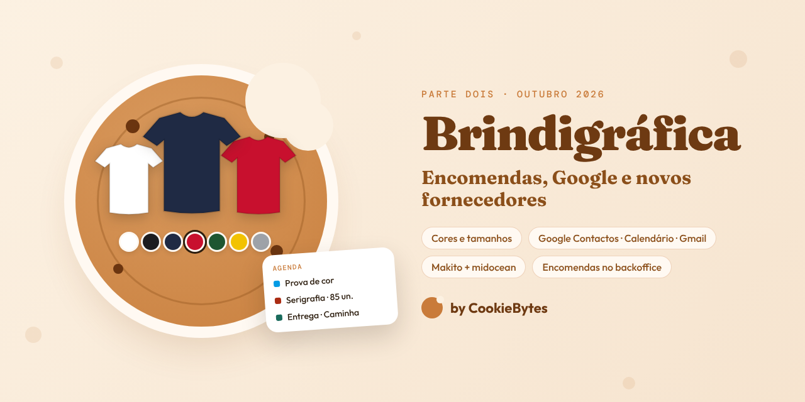
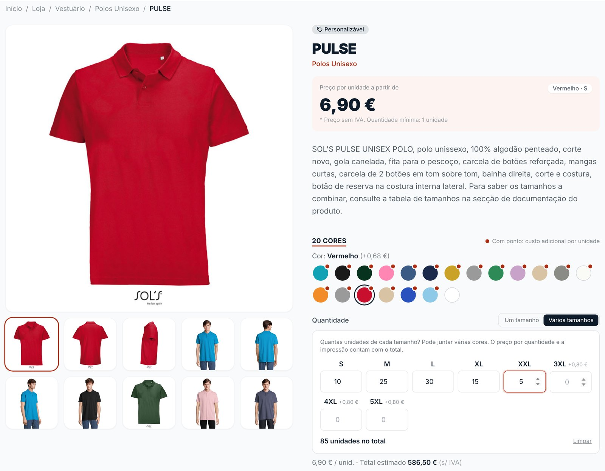
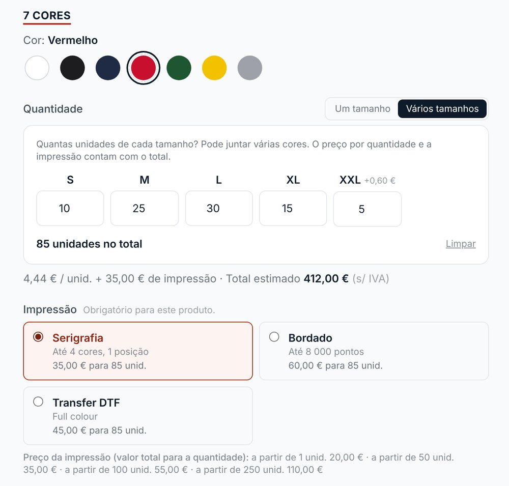
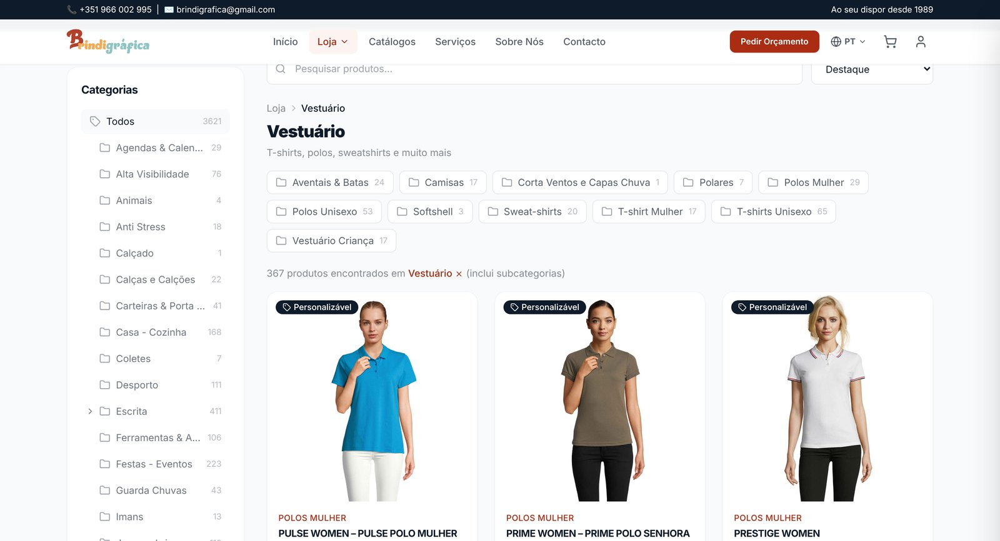
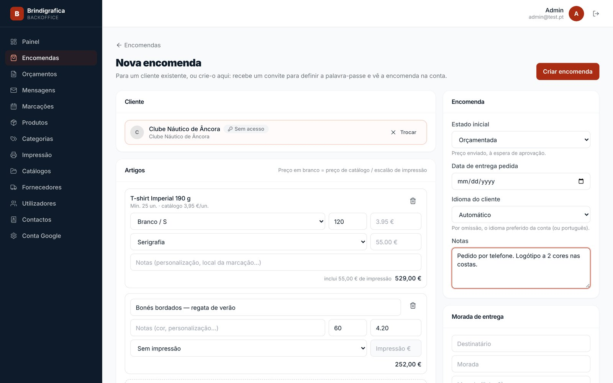
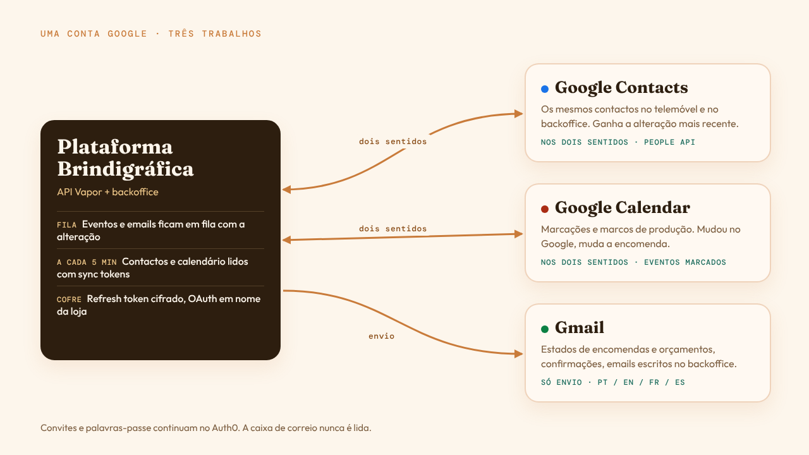
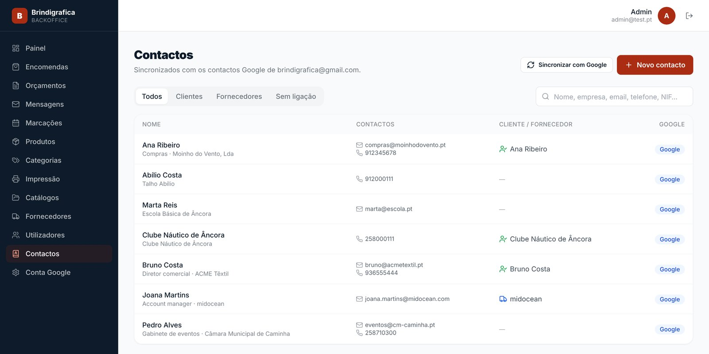
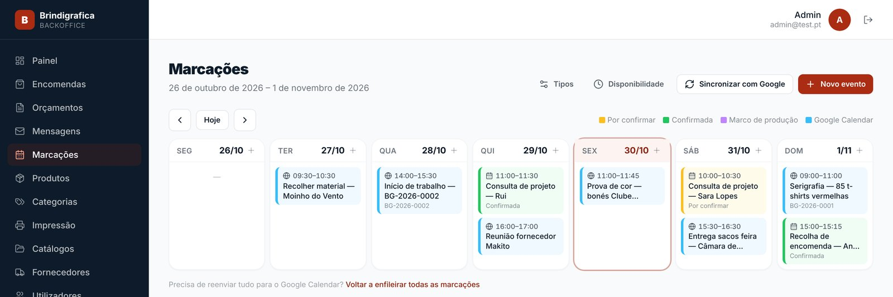
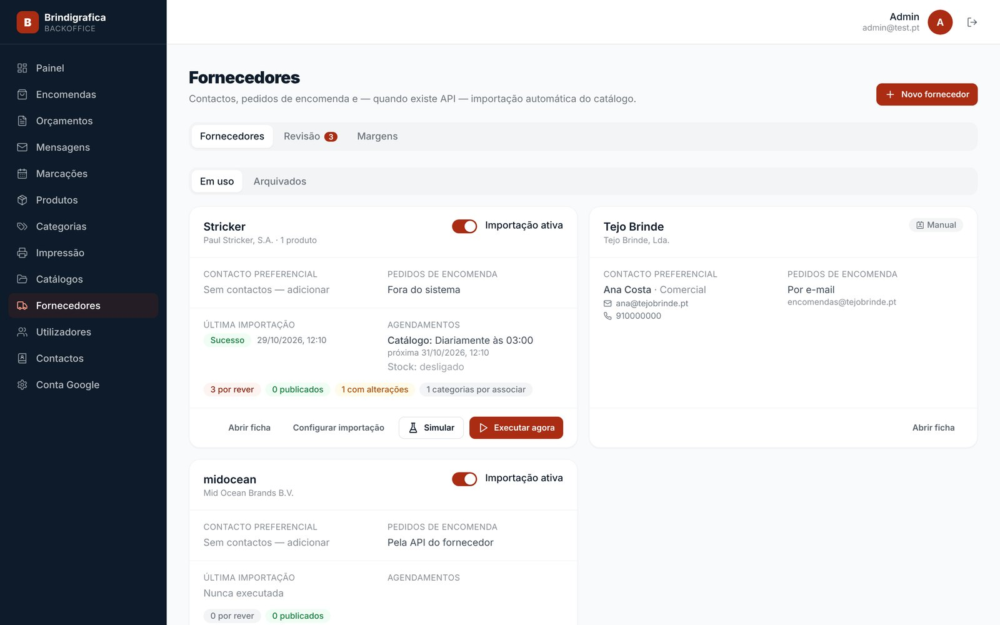

<figure>
  
</figure>

## O que mudou, e porquê

O [primeiro artigo](/pt/blog/site-brindigrafica/) terminava com um plano: pagamentos, integração com calendário, mais fornecedores. Os pagamentos continuam na gaveta — de propósito. Tudo o resto nesta página veio de ver a equipa a usar a plataforma a sério:

- Quem encomenda t-shirts não compra "50 × M preto". Compra *10 S, 25 M, 30 L, 15 XL e 5 XXL, em vermelho, com o logótipo nas costas*.
- Metade das encomendas ainda começa com um telefonema. A equipa precisava de as registar ela própria.
- Os contactos, a agenda e o email já vivem numa conta Google, no telemóvel. A plataforma tinha de se juntar a isso, não de competir.
- Uma parte do catálogo maior do que esperávamos vem dos fornecedores.

🍪 🍪 🍪

## Uma página de produto que vende roupa como ela é comprada

A página de produto foi refeita à volta de **seletores de variantes**. As cores são amostras, desenhadas a partir do código hex que o fornecedor envia (ou que se escreve no backoffice), e cada cor pode ter as suas fotografias — escolhe vermelho, a galeria mostra a vermelha. Os tamanhos são uma fila, por ordem natural (XS antes de S antes de M, `38` antes de `40`), e tudo o resto que varia — a capacidade de uma pen, a cor da tinta de uma caneta — passa a uma fila de opções. O mesmo componente serve um polo (cor × tamanho), uma caneca (só cor) e uma pen (cor × capacidade).

Depois há os **"Vários tamanhos"**: uma caixa de quantidade por tamanho, para a encomenda de uma equipa inteira entrar de uma vez — e pode mudar de cor e continuar, juntando várias cores no mesmo pedido.

<figure>
  
  <figcaption>A loja real: um polo SOL'S vindo da midocean, 20 cores, 85 unidades em cinco tamanhos.</figcaption>
</figure>

A parte interessante é o preço. Linhas do mesmo produto **com a mesma impressão e personalização são um só trabalho**:

- A quantidade *somada* escolhe o escalão de preço — 10 S e 25 M são 35 unidades, não duas encomendas pequenas.
- A quantidade mínima também é verificada no grupo, por isso 10 S + 15 M cumprem um mínimo de 25.
- A impressão é cobrada uma vez pelo trabalho todo e repartida pelas linhas conforme a quantidade, com o resto do arredondamento na última linha, para que os totais batam ao cêntimo.

Essa lógica vive numa única função pura na API, `LinePricing`, usada pelo carrinho e pelo checkout. A página mostra o mesmo valor que a encomenda vai ter.

### A impressão faz parte do produto

Brindes são sobretudo *impressão*, por isso os tipos de impressão passaram a ser uma peça própria: serigrafia, bordado, gravação laser, transfer DTF, cada um com os seus escalões. Um escalão é o **custo total da impressão da linha** para aquela quantidade — 85 t-shirts em serigrafia são 35 € de impressão, não 85 × qualquer coisa. Os tipos são oferecidos por categoria (e herdados pelas subcategorias) ou por produto, e quando um produto oferece impressão é obrigatório escolher uma — o carrinho não deixa passar uma t-shirt promocional sem impressão por engano.

<figure style="max-width: 520px;">
  
  <figcaption>Com os tipos de impressão configurados: o preço para 85 unidades, impressão incluída. (Dados de demonstração.)</figcaption>
</figure>

### Categorias dentro de categorias

O catálogo deixou de caber numa lista simples. As categorias podem agora ter até três níveis — *Vestuário › Polos Unisexo*, *Vestuário › T-shirt Mulher* —, os produtos podem estar em qualquer nível, e filtrar por uma categoria inclui tudo o que está por baixo. Os breadcrumbs, o menu e a árvore lateral vêm todos das mesmas ligações na API.

<figure>
  
  <figcaption>O catálogo real: 3 621 produtos, e só o Vestuário tem onze subcategorias.</figcaption>
</figure>

🍪 🍪 🍪

## Encomendas criadas ao balcão

O backoffice pode agora **criar encomendas em nome de um cliente**: escolher (ou criar) o cliente, juntar linhas do catálogo com o preço que a loja daria — ou linhas livres com preço escrito à mão, para o trabalho fora do catálogo —, escolher a impressão, definir o estado inicial e enviar.

<figure>
  
  <figcaption>Uma encomenda feita por telefone: uma linha do catálogo, uma linha livre. (Dados de demonstração.)</figcaption>
</figure>

Esta precisou de duas tentativas, e a primeira merece ser contada.

**A primeira** deixava uma encomenda pertencer só a um email — sem conta —, com os dados do cliente copiados para a encomenda e um passo para a "reclamar" mais tarde. Foi para o ar numa segunda-feira. Na terça já era claro que piorava tudo o que vinha a seguir: dois tipos de encomenda, dois sítios onde podia estar o nome do cliente e um fluxo de reclamação de que ninguém se ia lembrar.

**A segunda** diz que cada encomenda pertence a uma conta, ponto final. Se o cliente não tiver uma, o backoffice cria-a e o Auth0 envia-lhe um link para definir a palavra-passe — e a encomenda já lá está à espera no primeiro login. Um erro no email pode ser corrigido enquanto o convite está pendente.

Mas há clientes que *nunca* vão entrar. Um clube que telefona duas vezes por ano não quer uma palavra-passe. Por isso existem agora **clientes sem acesso**: uma conta a sério, com encomendas, orçamentos e histórico, mas sem utilizador no Auth0 — e o email é opcional. Se um dia quiserem entrar, o convite cria o acesso *na mesma conta*, e nada muda de sítio.

A migração que retirou a primeira tentativa tem uma proteção de que gostamos bastante: **recusa-se a correr enquanto houver uma encomenda sem conta**, e diz quais são. Convidam-se esses clientes na versão anterior, o que move as encomendas, e volta-se a fazer o deploy. Uma alteração ao esquema que não pode deixar dados órfãos em silêncio vale um deploy um pouco menos cómodo.

🍪 🍪 🍪

## Uma conta Google, três trabalhos

A loja vive numa única conta Google — os contactos no telemóvel, a agenda, o email. Em vez de construirmos uma segunda agenda de contactos, um segundo calendário e um servidor de email, a plataforma passou a ligar-se a essa conta.

<figure>
  
</figure>

Os **contactos** sincronizam nos dois sentidos. Edita-se no telemóvel ou no backoffice; ganha a alteração mais recente. Quando a plataforma escreve no Google, parte da cópia atual de lá, por isso o aniversário, a fotografia e os campos que não modelamos ficam intactos. Um contacto pode ser ligado a uma conta de cliente, passar a cliente ou passar a **fornecedor** — e os contactos cujo email pertence a um fornecedor ficam ligados automaticamente.

<figure>
  
  <figcaption>Os contactos Google da loja, com quem é cliente e quem é fornecedor. (Dados de demonstração.)</figcaption>
</figure>

O **calendário** também vai nos dois sentidos. Marcações e marcos de produção são escritos num calendário próprio, "Brindigráfica — Produção", e cada evento leva uma etiqueta privada que aponta para a marcação ou encomenda. As atualizações são PATCH, por isso as cores e notas que alguém junte no Google ficam. E depois o sentido que importa: **mudar um marco no Google Calendar muda a encomenda**, com uma nota no histórico. A agenda do backoffice mostra também o resto do calendário da conta, e a equipa pode criar eventos livres ("recolher material", "início de trabalho") sem sair dali.

<figure>
  
  <figcaption>Marcações, marcos de produção e eventos do Google numa só semana. (Dados de demonstração.)</figcaption>
</figure>

O **Gmail** envia os emails da plataforma: estados de encomendas e orçamentos, confirmações de "recebemos o seu pedido" (com cópia para a loja) e emails escritos no backoffice. Cada email entra em fila **na mesma transação** da alteração que o causou, por isso não há email sobre uma encomenda que não foi guardada, nem encomenda guardada que fique sem email. Um processo em segundo plano envia-os com novas tentativas espaçadas, as respostas sobre a mesma encomenda ficam na mesma conversa do Gmail e o modelo sai na língua do cliente — português, inglês, francês ou espanhol. Cada mudança de estado tem um interruptor "avisar o cliente por email", porque nem todas precisam de chegar à caixa de alguém.

### As partes que deram luta

- **Sem conta de serviço.** É uma conta Gmail normal, não Google Workspace, por isso uma conta de serviço não pode agir em nome dela. O backoffice faz o consentimento OAuth uma vez, *como a loja*, e a API guarda o refresh token cifrado no mesmo cofre das credenciais dos fornecedores. As permissões são mínimas de propósito — só `gmail.send`; a caixa de correio nunca é lida.
- **Os sync tokens expiram.** Os tokens de sincronização incremental do Google duram cerca de uma semana. Quando um caduca, a sincronização faz uma listagem completa e trata o que falta como apagado no Google. Errar aqui seria apagar contactos, por isso tem testes próprios.
- **Um email atrasado é pior do que nenhum.** Se a conta ficar desligada uns dias, os emails automáticos com mais de três dias são dados como falhados em vez de enviados. Ninguém precisa de um "recebemos a sua encomenda" uma semana depois.
- **Os convites ficam no Auth0.** Os emails de conta (definir palavra-passe, verificar) continuam a vir do Auth0, que já trata da validade e da entrega.

🍪 🍪 🍪

## Dois novos fornecedores, e encomendas que voltam para eles

O primeiro artigo falava de três ligações — Stricker, Cifra e Valento. Agora há mais duas.

A **Makito** é onde a Brindigráfica compra muito produto em branco para depois imprimir. A API de dados deles veio com uma especificação em PDF e mais nada, e escrevemos a ligação **antes de termos credenciais**. Por isso lê com tolerância — aceita as formas que o PDF descreve e as variações que deixa adivinhar — e espera quando bate no limite de pedidos, em vez de falhar.

A **midocean** foi uma boa surpresa: a SOL'S, a NEOBLU e mais umas marcas que a Brindigráfica compra são vendidas através dela — por isso a SOL'S, que no primeiro artigo aparecia "sem integração", passou a ter uma. Uma ligação, um fornecedor, o catálogo todo: o feed de produtos chega como um link para um único ficheiro JSON de ~36 MB — 2 786 produtos e 21 738 variantes —, que a API **lê em stream** em vez de carregar para memória, com os textos em inglês, francês e espanhol juntos como traduções. A midocean não envia códigos hex das cores, por isso uma cor escrita no backoffice mantém-se entre sincronizações.

Como antes, nada importado vai para o ar sozinho: entra numa fila de revisão e é a equipa que publica.

No sentido inverso, o backoffice prepara agora **pedidos de encomenda aos fornecedores** a partir da encomenda do cliente — um por fornecedor, com as linhas da encomenda — e acompanha-os de rascunho a enviado, confirmado e recebido. Para a midocean há um botão **"Enviar via API"** que faz a encomenda diretamente, com os SKU das variantes e a morada de entrega da loja. Continua a ser alguém a clicar, e só aparece depois de confirmar que dá para enviar (credenciais, morada completa, SKU em todas as linhas).

<figure>
  
  <figcaption>Cada fornecedor é primeiro uma ficha de contacto; a ligação por API é opcional. (Dados de demonstração.)</figcaption>
</figure>

🍪 🍪 🍪

## O que vem a seguir

- **Enviar como @brindigrafica.pt.** Os emails saem hoje do endereço Gmail da loja; um alias "Enviar como" vai pôr o domínio deles no remetente.
- **Preços da midocean.** A lista de preços da conta ainda está a ser gerada do lado da midocean; quando chegar a primeira, os produtos importados ganham custo e as margens entram em ação.
- **Pagamentos online** — continuam, de propósito, para mais tarde. Orçamentos e faturas são como a maior parte deste negócio se faz.

🍪 🍪 🍪

## A lição, outra vez

Todas as mudanças aqui vieram do dia a dia da equipa, não do plano. A melhor funcionalidade que lançámos este mês foi desfazer uma que tínhamos lançado na véspera. Lançar cedo, com pessoas reais a usar, é a forma de descobrir qual é o modelo certo do negócio.

A loja está em [brindigrafica.pt](https://brindigrafica.pt/) e a página do projeto está [nos nossos projetos](/pt/portfolio/brindigrafica/). Precisa de uma loja que se adapte à forma como a sua equipa já trabalha? [Fale connosco](/pt/#contact).
