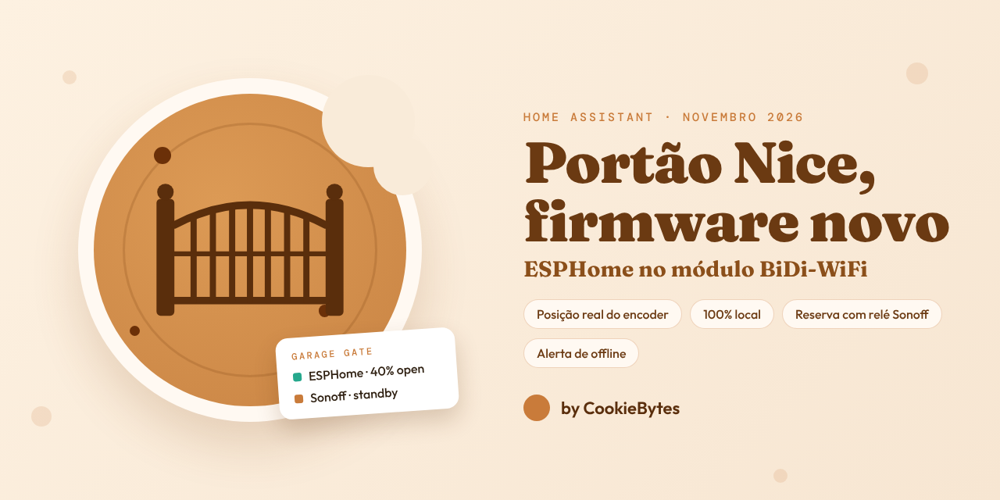
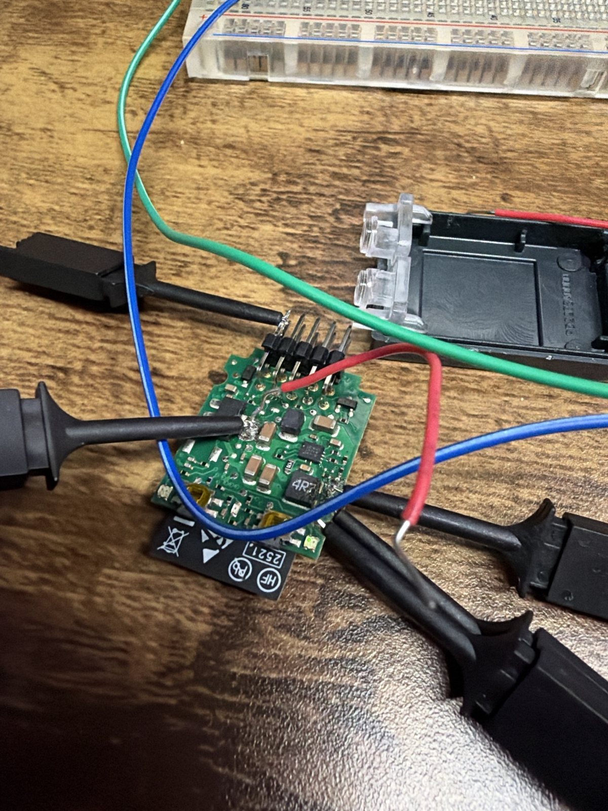
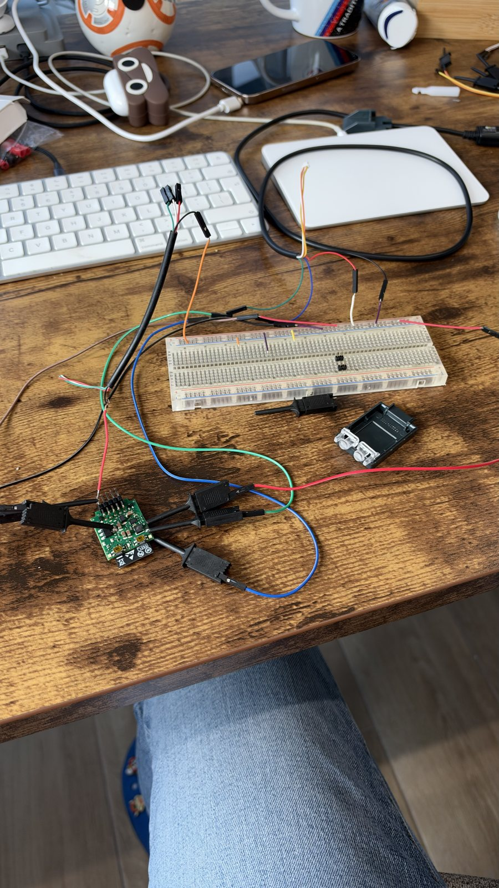

<figure>
  
</figure>

## O ponto de partida: o módulo Nice, através da cloud

O motor é um Nice e, ligado a ele, está um módulo **BiDi-WiFi** — a pequena placa que põe o portão na app MyNice. Foi aí que isto começou: o portão já era "inteligente", por isso o passo óbvio era ligar o que já lá estava.

A MyNice tem um serviço no **IFTTT**, e essa foi a ponte. Para abrir o portão, o Home Assistant chamava o IFTTT, o IFTTT chamava a cloud da Nice, a cloud da Nice chegava ao módulo, e o módulo dava a ordem ao motor. O estado voltava pelo mesmo caminho, ao contrário, em webhooks.

Num dia bom, funcionava. Os problemas eram as camadas:

- **Os comandos eram lentos.** Cada toque passava pelo IFTTT e pela cloud da Nice antes de chegar a um portão a poucos metros. Carregava-se em "abrir" e esperava-se, sem saber se a ordem vinha a caminho ou se se tinha perdido.
- **Não era fiável.** Com tantos saltos, bastava um deles ter um mau momento — a internet, o IFTTT, a Nice — para o comando chegar tarde ou não chegar. Um portão que abre às vezes é pior do que um portão sem inteligência nenhuma.
- **Só estados finais.** "Abriu" e "fechou", nada pelo meio: sem posição, sem "parou a meio".
- **Nada local.** Uma casa que precisa de dois serviços externos para abrir o seu próprio portão não era onde queríamos estar.

🍪 🍪 🍪

## O atalho: um relé Sonoff

A solução para os comandos lentos foi a mais direta possível. Um motor de portão tem uma entrada "passo a passo": fecha-se o contacto e o portão faz a ação seguinte — abrir, parar, fechar. Liga-se um **relé Sonoff** a essa entrada, dá-se um impulso de um segundo a partir do Home Assistant, e o portão mexe-se de imediato, tudo na rede local.

Isso resolveu a rapidez e a fiabilidade dos comandos. Não resolveu o *saber*. Um relé consegue carregar no botão; não consegue ver o portão. Sozinho, o Home Assistant só sabe o que pediu, e isso desfaz-se assim que:

- alguém usa o **comando físico** — o Home Assistant nunca chega a saber;
- o portão **pára a meio** por causa de um obstáculo;
- um impulso se perde e, a partir daí, "aberto" e "fechado" ficam trocados.

E tudo o que vem a seguir depende desse estado: a automação que fecha o portão quando a garagem está sossegada, o alerta de "aberto há demasiado tempo", o alarme. É por isto que o Sonoff nunca foi a resposta completa: mãos rápidas, sem olhos. O estado real tinha de continuar a vir do motor.

🍪 🍪 🍪

## De volta ao módulo, desta vez localmente

O módulo sabia tudo o que queríamos; o problema era o caminho pela cloud. Por isso o passo seguinte foi perguntar ao próprio módulo, pela rede local.

Para isso usámos a **[homeassistant_nice](https://github.com/Jordi-14/homeassistant_nice)**, a integração personalizada do Jordi-14 para o Home Assistant. Fala o mesmo protocolo não documentado que a app MyNice usa, diretamente com o BiDi-WiFi na rede local. O módulo exige credenciais próprias para isso, e essas vivem dentro da app — por isso a configuração começou por extraí-las de uma cópia de segurança dos dados da MyNice.

É um trabalho sério, e levou-nos longe: estado real de aberto/fechado sem cloud pelo meio, e o próprio encoder — fechado em `0`, totalmente aberto em `5523`, com um percurso completo de cerca de 18 segundos.

Depois quisemos **posições intermédias** — abrir 5% para arejar a garagem, 75% para entrar a pé. O módulo original não tem um comando "vai para 40%", por isso a integração tinha de o fazer por fora: arrancar o portão, consultar a posição duas vezes por segundo, enviar *stop* no momento certo e aprender quanto é que o portão ainda desliza depois. A integração tem uma rotina de calibração para isso mesmo, e os relatórios são leitura honesta:

| Alvo | Primeira tentativa parou em | Melhor tentativa |
| --- | --- | --- |
| 20% | 29% | 21,8% |
| 40% | 51% | 39% |
| 60% | 77% | 60,9% |

As boas tentativas eram boas. O problema era a repetibilidade — o atraso entre "pára agora" e o portão receber de facto a ordem variava entre 30 ms e 230 ms de uma vez para a outra e, a 5% de percurso por segundo, isso é a margem de erro toda. No nosso portão, duas calibrações completas na mesma manhã terminaram ambas em *failed*.

No dia a dia também não era estável: a ligação ao módulo ia e vinha, e com ela o estado do portão. Nada disto é culpa da integração — o código faz o melhor que é possível fazer por fora. A instabilidade é do próprio módulo.

### O verdadeiro problema: privacidade

E depois havia o que mais nos incomodava. Com controlo local ou sem ele, **o módulo continuava a falar com a cloud MyNice**. O firmware original liga para casa, e nada do que fizéssemos no Home Assistant mudava isso. Um dispositivo na nossa rede que decide quando abre o portão do edifício mantinha uma linha permanente para os servidores de outra empresa — cada movimento comunicado, e um caminho remoto até ao portão que não controlávamos nem tínhamos pedido.

Fizemos então o óbvio e **bloqueámo-lo na firewall**: uma regra a impedir o módulo de chegar à cloud da Nice.

O portão deixou de funcionar.

Sem acesso à sua cloud, o módulo original não se portava bem, ligação local incluída. Ou seja, o "local" vinha com asterisco: só se aguentava enquanto a cloud pudesse entrar. Podíamos ter privacidade ou um portão a funcionar, não as duas coisas.

🍪 🍪 🍪

## O último passo: substituir o firmware

Ficou decidido. Enquanto o firmware da Nice estivesse naquela placa, a cloud vinha atrás — a única forma de ter **privacidade** era substituir o firmware. E, tecnicamente, estávamos de qualquer modo do lado errado do módulo. Tudo o que queríamos estava no conector **Bus-T4** do motor — e estávamos a pedi-lo através de Wi-Fi, de um protocolo do fabricante e de um ciclo de consultas.

O módulo BiDi-WiFi é, por baixo, um **ESP32**. Em vez de falar *com* o firmware dele, substituímo-lo por **[ESPHome](https://esphome.io/)** com o **[esphome-BusT4](https://github.com/makstech/esphome-BusT4)**, o componente Bus-T4 de código aberto do makstech, para que a mesma placa fale diretamente com o motor e nativamente com o Home Assistant:

- **A posição vem do encoder, em tempo real**, lida no próprio barramento à medida que o portão se move — e não pedida através da rede.
- **O "pára nos 40%" é decidido na placa**, mesmo ao lado do motor, e não do outro lado da rede.
- **Privacidade.** A placa deixou de falar com quem quer que seja fora de casa. Sem cloud MyNice, sem conta na app, sem credenciais extraídas, sem regras de firewall para vigiar — é um dispositivo ESPHome local como qualquer outro cá de casa.
- Atualiza-se pelo ar, como os restantes dispositivos ESPHome.

Do que abdicámos: a app MyNice. Ninguém lhe sentiu a falta.

<figure style="max-width: 420px;">
  
  <figcaption>A placa BiDi-WiFi fora da caixa, com as pinças prontas para gravar por série.</figcaption>
</figure>

### A gravação

O módulo saiu do motor e veio para a secretária, seguindo o guia do [esphome-BusT4](https://github.com/makstech/esphome-BusT4): um adaptador USB-série, uma breadboard e pinças de teste nos pontos de programação da placa.

**A primeira coisa que fizemos foi ler a flash original e guardá-la** — a imagem de fábrica completa, duas vezes. Se o ESPHome não resultasse, o módulo podia voltar a ser exatamente o que a Nice vendeu. Só depois entrou o firmware novo.

<figure style="max-width: 420px;">
  
  <figcaption>Nada de glamoroso: uma breadboard, um adaptador série e muita paciência com pinças.</figcaption>
</figure>

De volta ao motor, a placa encontrou a central no barramento, leu os limites e apareceu no Home Assistant como uma cobertura com posição real — mais os comandos *passo a passo* e *abertura parcial* do próprio motor, como botões.

🍪 🍪 🍪

## No Home Assistant: um portão, dois caminhos

Esta é a parte que mais nos importa. O relé Sonoff nunca saiu de lá. Continua ligado à entrada passo a passo e agora é a **reserva**.

Tudo em casa — painéis, automações, voz — fala com **uma** entidade do portão. Por trás dela há uma pequena camada que escolhe o caminho:

- **Módulo online →** os comandos vão para o módulo ESPHome, e o estado e a posição são os reais, vindos do encoder.
- **Módulo offline →** os mesmos comandos de abrir/fechar/parar dão impulsos no relé Sonoff, e o estado passa a ser uma estimativa por temporizador local (os webhooks do IFTTT já não existem).

Se o módulo perder o Wi-Fi, reiniciar ou avariar, o portão continua a abrir no mesmo botão. Ninguém precisa de saber que caminho está a ser usado.

Três detalhes tornam essa troca limpa:

- **A reserva está sempre atualizada.** Cada mudança de estado que o módulo comunica é copiada para o estado da reserva. Um relé passo a passo só faz sentido se soubermos onde está o portão; assim, quando o módulo falha, a reserva parte da verdade e não de um palpite antigo.
- **As posições degradam com juízo.** Pedir uma posição em modo de reserva passa a ser abrir ou fechar por completo — o relé não sabe fazer 40%, e preferimos que faça algo previsível.
- **Sem saltos.** Durante uns segundos após um comando, a camada mantém "a fechar" mesmo que o módulo ainda diga "aberto", para o painel não oscilar.

### O módulo está vivo?

Uma reserva silenciosa é uma armadilha: o portão continua a funcionar, por isso nunca daríamos conta de que o caminho bom tinha desaparecido. Por isso o Home Assistant vigia o módulo. Se estiver inacessível há **15 minutos** (ajustável no painel), recebemos uma notificação no telemóvel a dizer que o portão está a funcionar pela reserva Sonoff e que o estado é estimado — e outra quando o módulo volta. A segunda só é enviada se a primeira tiver sido, por isso um reinício rápido passa em silêncio.

### O que isto desbloqueou

Com uma posição em que se pode confiar, as automações que já existiam melhoraram sem serem reescritas, e apareceram dois botões novos:

- **Ventilate** — abre o portão a 5% para arejar a garagem.
- **Pedestrian** — abre a 75%, o suficiente para entrar a pé sem o percurso todo.
- **Fechar quando está sossegado** — se a câmara não vir nenhuma pessoa nem nenhum veículo durante cinco minutos e o portão continuar aberto, fecha-o. Agora age sobre o estado real, comando físico incluído.
- **Aberto há demasiado tempo** — um aviso no telemóvel ao fim de 30 minutos aberto.

Os dois botões de posição ficam simplesmente indisponíveis enquanto o módulo está offline, porque a reserva não os consegue fazer.

🍪 🍪 🍪

## O que levamos daqui

- **Ir à fonte.** Cada passo aproximou-nos do motor — cloud, depois o módulo na rede local, depois o próprio barramento — e cada um foi mais rápido e mais fiável do que o anterior.
- **Local só é privado depois de testar a firewall.** A integração era local; o módulo por baixo dela não. Bloquear-lhe a saída foi o teste — e o firmware original chumbou.
- **Apoiar-se em bom trabalho.** Nenhum dos passos teria acontecido sem a [homeassistant_nice](https://github.com/Jordi-14/homeassistant_nice) e o [esphome-BusT4](https://github.com/makstech/esphome-BusT4). Obrigado aos dois.
- **Cópia de segurança antes de gravar.** Uma cópia completa do firmware de fábrica transformou uma mudança arriscada numa mudança reversível.
- **Manter o caminho simples.** Um relé na entrada passo a passo é a coisa menos inteligente desta instalação, e a razão pela qual pudemos fazer experiências num portão de que precisamos todos os dias.
- **Vigiar a reserva.** Uma reserva que não sabemos que estamos a usar é só uma avaria mais lenta.

Tem um portão, uma porta de garagem ou outra coisa qualquer que só fala com a sua própria app? [Fazemos instalações e integrações](/pt/#contact) — chave suplente incluída.
