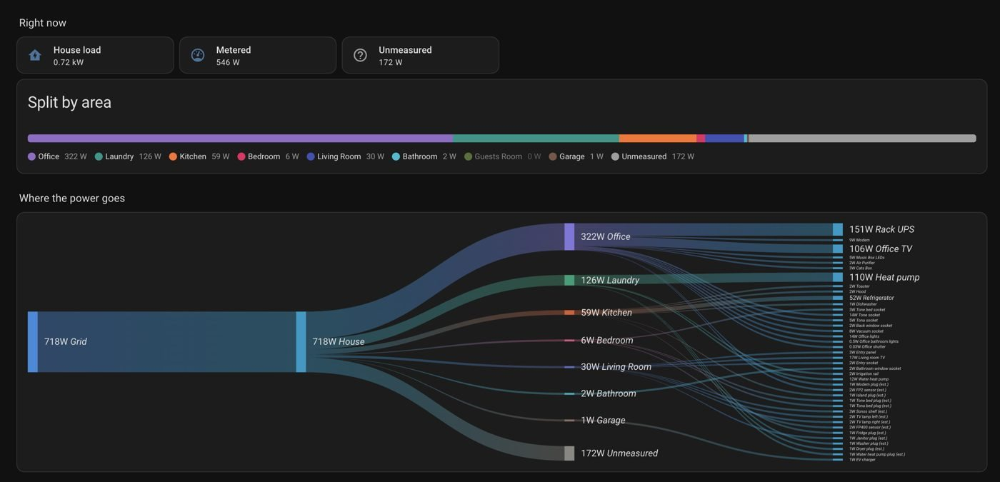
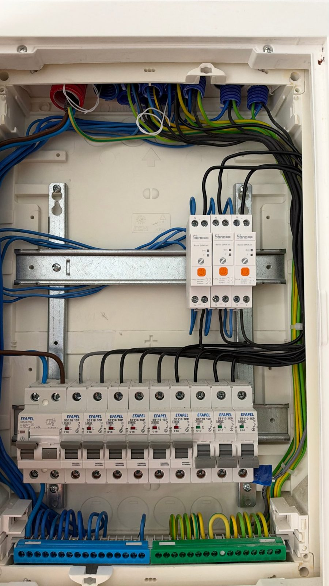
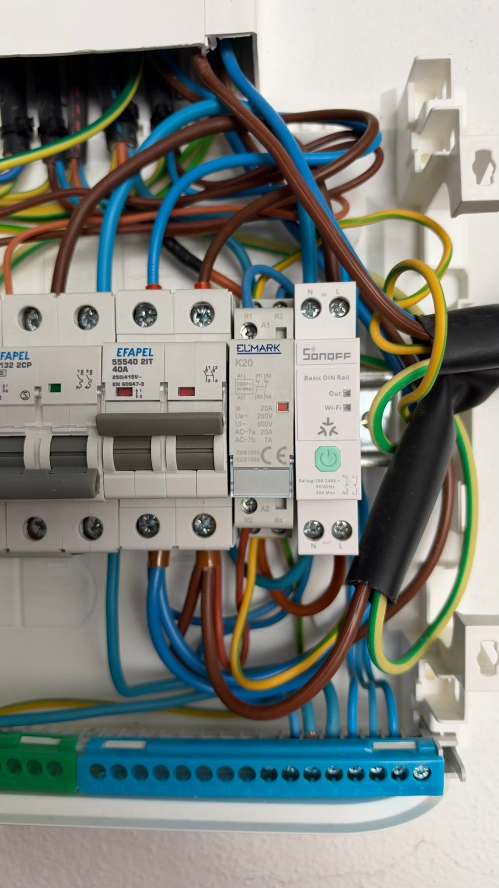

<figure>
  
  <figcaption>A vista Consumption, numa terça-feira à noite: 718 W da rede, divididos por divisão e até ao dispositivo individual.</figcaption>
</figure>

## O problema: um número grande

A casa funciona com um inversor híbrido, bateria e painéis solares no telhado, e o Home Assistant já sabe muito a partir dele: o que os painéis produzem, o que a bateria faz, o que importamos ou exportamos da rede e a **carga da casa** — o total de tudo o que está a ser consumido neste momento.

Esse número é o ponto de partida para qualquer pergunta e é inútil para a pergunta seguinte. *Porque* é que são 720 W às 22:40, numa noite sossegada? É o bastidor da rede? A bomba de calor? A televisão que alguém se esqueceu de desligar? O painel de energia do Home Assistant mostra dispositivos individuais, mas só os que medimos — por isso o trabalho a sério não é o painel. É a medição.

🍪 🍪 🍪

## Três sítios onde medir

Não quisemos uma abordagem única, porque uma casa não tem um único tipo de carga. No fim ficaram três, cada uma para um trabalho diferente.

### 1. Relés atrás das tomadas

Nas tomadas de parede pusemos um pequeno **relé Zigbee Sonoff com medição de energia** atrás da tomada. A tomada continua a ser uma tomada normal — ninguém precisa de saber que lá dentro há algo inteligente — mas o Home Assistant passa a ver potência, corrente, tensão e energia do que lá estiver ligado, e pode desligá-lo.

Foi assim que as televisões, a torradeira, a air fryer, a máquina de café, o exaustor e as tomadas das janelas ficaram medidos. Dois detalhes de que gostamos:

- **Os limites de proteção vêm no relé.** Cada um tem limiares de sobrecarga configuráveis; os nossos estão a 16 A e 3 840 W.
- **Modo de desacoplamento.** O relé pode ser desligado da sua entrada física, para que o lado da parede e o lado da automação façam cada um o seu trabalho.

### 2. Fichas inteligentes para o que se move

Nem tudo está ligado a uma tomada fixa. A máquina de lavar roupa, a de secar, o frigorífico, a bomba de calor da água e mais alguns equipamentos usam **fichas inteligentes Zigbee Sonoff** — a mesma ideia, mas de encaixar. Baratas, substituíveis e sem ferramentas.

### 3. Relés no quadro elétrico

As cargas grandes e os circuitos inteiros medem-se melhor na origem. Nos quadros usamos **relés Sonoff de calha DIN**, que encaixam na calha ao lado dos disjuntores. No piso de cima são a versão Zigbee: um para as luzes do escritório, outro para as luzes da casa de banho do escritório e outro para o motor do estore.

<figure style="max-width: 420px;">
  
  <figcaption>Três relés Zigbee de calha DIN por cima dos disjuntores. O mesmo relé, três circuitos, três linhas no painel.</figcaption>
</figure>

A bomba de calor, o carregador do carro elétrico, a rega, a cozinha exterior e as tomadas exteriores são o outro grupo. Usam a **versão Wi-Fi** do mesmo relé de calha, e esses falam **Matter** em vez de Zigbee.

<figure style="max-width: 420px;">
  
  <figcaption>O relé Wi-Fi/Matter, ao lado de um contactor. Quanto maior a carga, mais a cablagem mostra quem manda.</figcaption>
</figure>

<strong>Uma nota de segurança.</strong> Trabalhar no quadro é trabalhar com a rede elétrica. Os relés são a parte fácil; a potência, a proteção e a cablagem não são. Dimensione para a carga, não para o máximo do relé. Fizemos a cablagem do nosso, e faz parte do que fazemos para clientes. Se não se sente à vontade dentro de um quadro, não improvise.

🍪 🍪 🍪

## Quem fala com quem

É uma casa mista. Os medidores falam dois protocolos, Zigbee e Matter, e o inversor e a UPS entram pelas suas próprias integrações.

| O quê | Como liga | Porquê |
| --- | --- | --- |
| **Relés de parede, fichas e os relés de calha DIN do escritório** | **Zigbee**, através do **Zigbee2MQTT** | Local, sem cloud, rede em malha, e os dispositivos ligados à rede elétrica ajudam a transportar o sinal uns dos outros |
| **Coordenadores e routers Zigbee** | Dispositivos **SMLIGHT** ligados à rede — um coordenador na sala, routers no escritório, no quarto e na lavandaria | Cobertura Zigbee em vários pisos, em vez de uma pen USB num servidor |
| **Bomba de calor, carregador do carro, rega, cozinha exterior, tomadas exteriores** | **Matter sobre Wi-Fi** | Multi-administrador: o relé da bomba de calor está emparelhado com o Home Assistant, o Apple Home e a UniFi ao mesmo tempo |
| **Inversor, bateria, solar** | Integração **FoxESS**, mais o **Forecast.Solar** para a previsão de produção | Fonte de verdade do total da casa |
| **Bastidor de rede** | Integração **Eaton UPS**, pela placa de rede da UPS | A saída real do bastidor, em watts e em energia |

O Zigbee faz a maior parte do trabalho, e é essa a ideia: **muitos medidores pequenos a enviar pequenas atualizações é exatamente aquilo em que uma malha local é boa**, e nada disso tem de sair de casa. O Matter trata da bomba de calor, do carregador do carro e dos circuitos exteriores, e o mais giro até agora é o multi-administrador: o mesmo relé aparece em três sistemas ao mesmo tempo.

🍪 🍪 🍪

## Dos sensores a uma resposta

Medir é metade do trabalho. A outra metade é fazer as contas baterem certo.

1. **A potência e a energia de cada dispositivo** vêm dos relés.
2. **Os totais por divisão** são grupos do Home Assistant que somam a potência de todos os dispositivos dessa divisão: Escritório, Lavandaria, Cozinha, Quarto, Sala, Casa de banho, Quarto de hóspedes e Garagem.
3. **A energia diária por divisão** vem de contadores (utility meters) por cima desses totais, que reiniciam à meia-noite — por isso "hoje" é sempre hoje.
4. **Nada é contado duas vezes.** Na configuração de energia, cada dispositivo está marcado como *incluído* no total da sua divisão, por isso a Rack UPS fica dentro do Escritório e o Escritório não a conta de novo.
5. **"Não medido" é um número, não uma desculpa.** É um simples template: a carga da casa vinda do inversor menos a soma de todas as divisões. O que não está medido aparece como uma barra própria, para que o painel nunca exagere, em silêncio, o que sabemos.

A última peça é o **powercalc**. Mesmo uma tomada perfeitamente medida tem uma ficha inteligente que gasta um pouco por si própria, e uma coluna Sonos, um sensor de presença ou uma lâmpada de cabeceira podem ser demasiado pequenos ou incómodos de medir. O powercalc dá-nos um valor modelado para esses casos, e marcamos cada um com **(est.)** no painel, para ninguém confundir um modelo com uma medição.

🍪 🍪 🍪

## O painel

O painel de energia tem cinco vistas, e usamo-las para perguntas diferentes:

- **Overview** — solar, casa, bateria, rede e carregador do carro em direto, com um cartão animado do fluxo de energia no topo e a distribuição por divisão por baixo.
- **Electricity** — os cartões de energia padrão do Home Assistant: consumo, solar, fontes e um Sankey para o período escolhido.
- **Now** — as últimas 24 horas de solar, casa, bateria, rede e carregador, mais o estado do inversor e da bateria.
- **Consumption** — a da imagem: casa, medido e não medido no topo, a distribuição por divisão em direto e um diagrama de Sankey da rede, passando pela casa e pelas divisões, até aos dispositivos individuais.
- **Bills** — quanto custou até agora este período de faturação, a fatura projetada e uma **verificação de fatura**, onde escrevemos o que o comercializador faturou e comparamos com o que esperamos para esses quilowatts-hora.

O diagrama de Sankey é onde toda a gente pára. É feito com um cartão personalizado, usa os mesmos sensores de grupo e de dispositivo, e atualiza a cada dois segundos.

### O que dizia numa terça-feira à noite

Quando captámos a imagem do topo, por volta das 22:40, a casa estava a consumir **718 W da rede**. **546 W estavam medidos e 172 W não** — ou seja, cerca de 76% contabilizados. A distribuição por divisão:

| Divisão | Potência |
| --- | --- |
| Escritório | 322 W |
| Lavandaria | 126 W |
| Cozinha | 59 W |
| Sala | 30 W |
| Quarto | 6 W |
| Casa de banho | 2 W |
| Garagem | 1 W |
| Não medido | 172 W |

Ao ampliar, a maior linha individual era a **Rack UPS, com 151 W** — a UPS que alimenta o bastidor de rede — à frente da **bomba de calor, com 110 W**, e da **televisão do escritório, com 106 W**. Mais abaixo: o **frigorífico, com 52 W**, e, no canto, a **Cats Box**, com 3 W.

Nada disto é surpreendente depois de se ver. Mas antes não sabíamos, adivinhávamos, e agora cada um desses números tem um histórico por trás.

🍪 🍪 🍪

## O que levamos daqui

- **Medir na origem.** Um relé na parede ou na calha vê a carga real. Uma estimativa a partir do total da casa só consegue adivinhar.
- **Misturar protocolos de propósito.** Zigbee para as muitas coisas pequenas, Matter onde o dispositivo for melhor assim. O que importa é que seja local e que tudo acabe num só sítio.
- **Identificar as estimativas.** O painel mais fiável é o que diz quais são os números adivinhados.
- **Manter a barra "não medido".** Aqueles 172 W não são um defeito — são a lista do que ainda não sabemos, e é aí que vamos continuar a procurar.
- **Evitar contar duas vezes.** No momento em que se mede uma divisão *e* o que está lá dentro, é preciso uma regra clara sobre quem é dono da energia.
- **A cablagem faz parte do trabalho.** Fomos nós que ligámos estes quadros. Um painel só é tão bom como o que está atrás dos disjuntores, por isso tratamos das duas pontas: os relés na calha e os números no ecrã.

Quer saber para onde vai a sua energia? [Fazemos a medição, a cablagem do quadro e os painéis](/pt/#contact) — e deixamos os gatos em paz.
