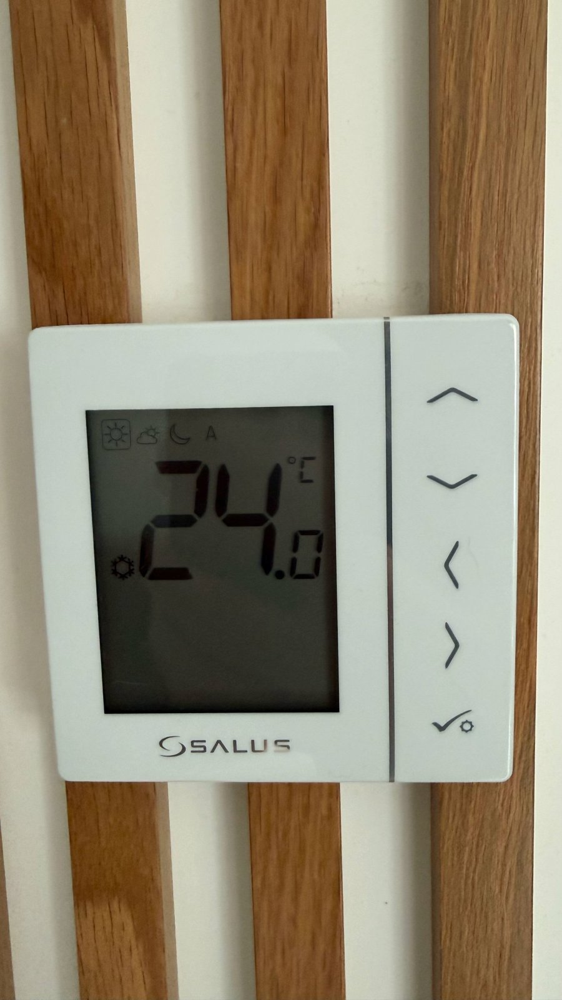
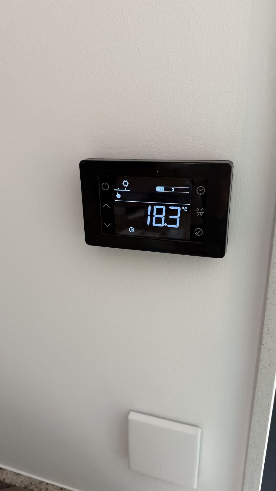
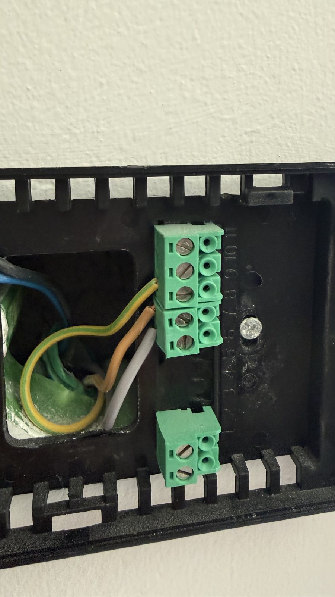
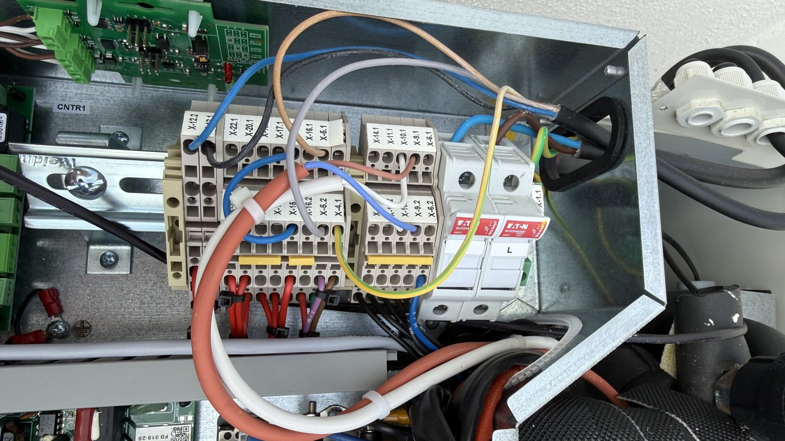
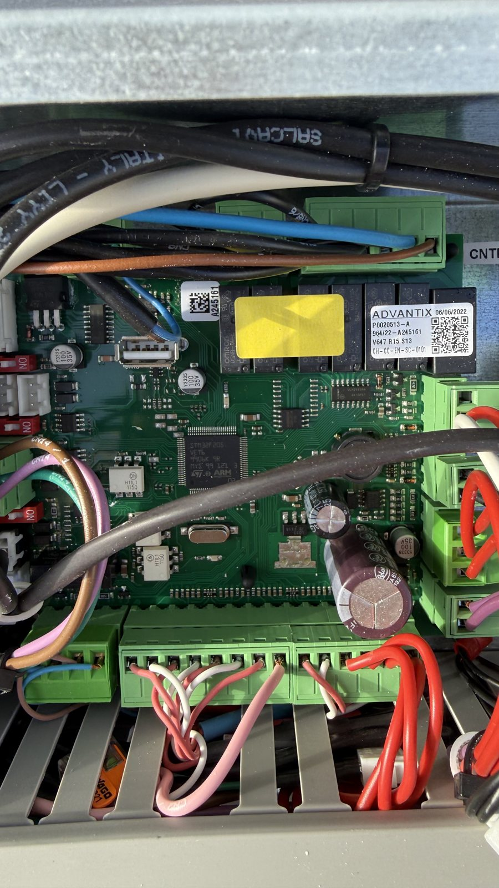
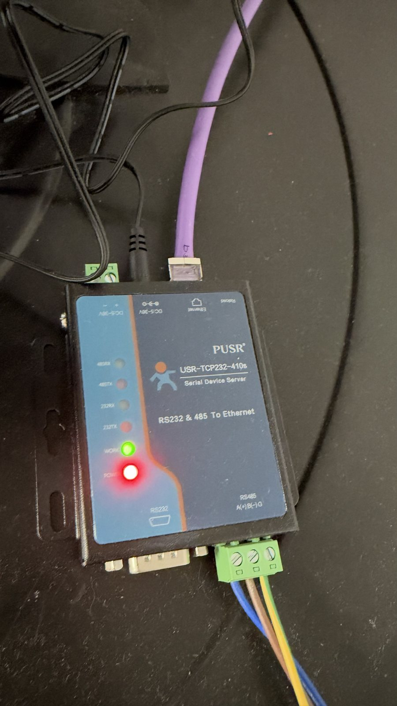
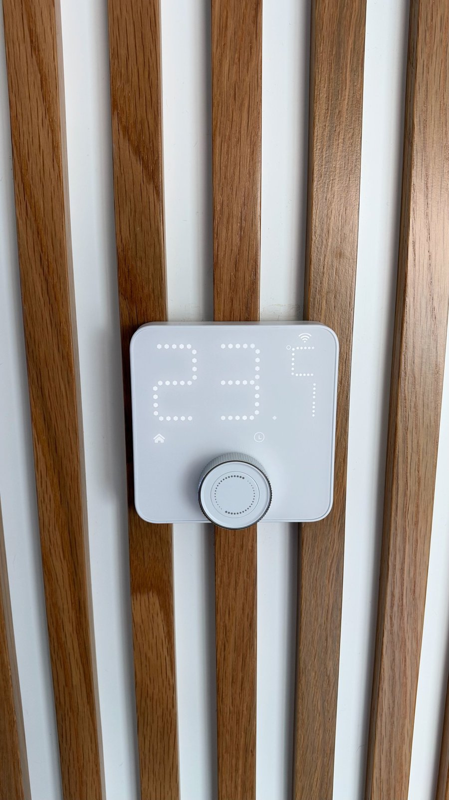
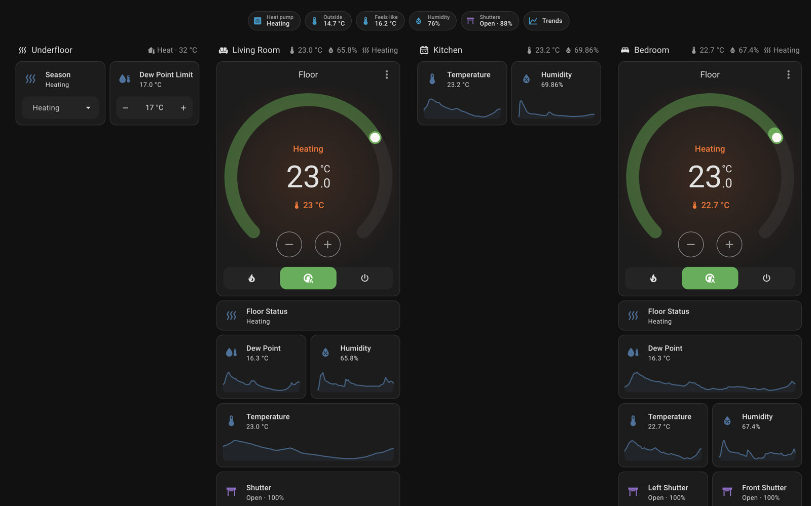
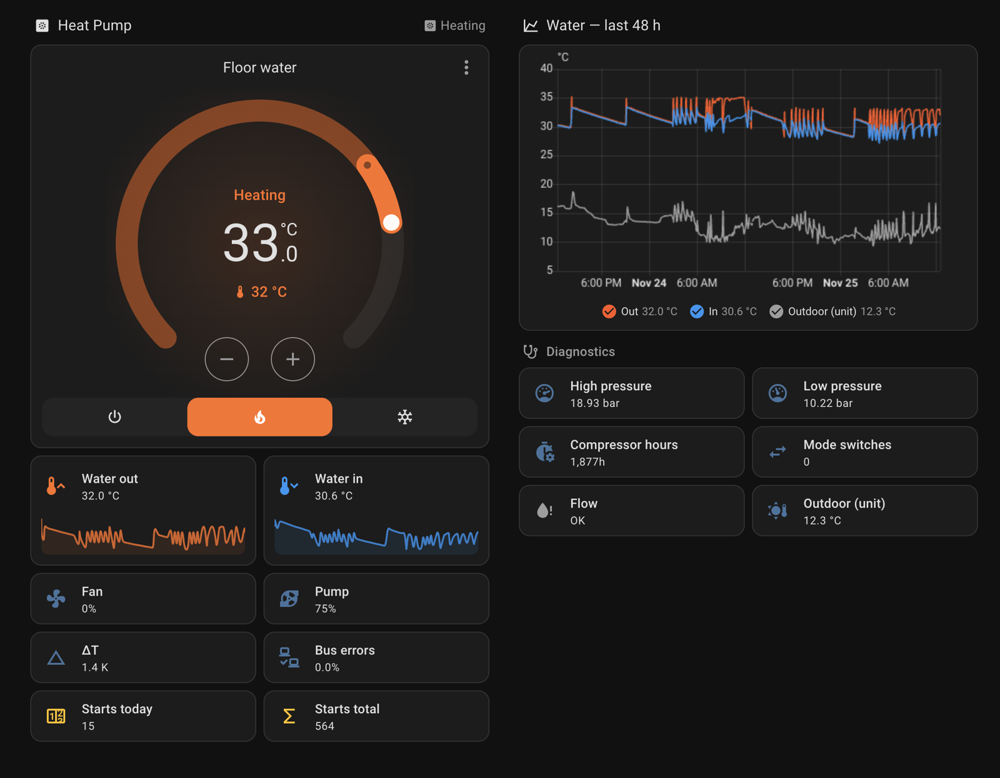
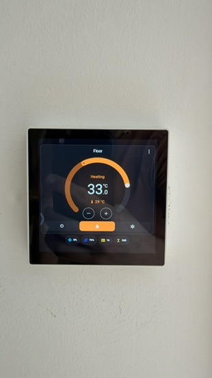

## O ponto de partida: um sistema de clima com que ninguém conseguia falar

A instalação é comum nas casas portuguesas mais recentes:

- uma **bomba de calor ar-água** no exterior — vendida como Áurea+, que por baixo é uma MAXA / Advantix **i-HWAK V4** — a mandar água quente para o chão no inverno e água fresca no verão;
- uma **central de ligações** que abre e fecha os circuitos do piso;
- um **termóstato de parede em cada uma das seis zonas** — sala, quarto, casa de banho, quarto de hóspedes, escritório e casa de banho do escritório — a dizer à central quando a sua divisão quer água.

O Home Assistant gere tudo o resto nesta casa: estores, luzes, alarme, rega, o portão da garagem, o dashboard de energia. O sistema de clima era o buraco no meio. **Não tínhamos acesso a nada:**

- **A bomba de calor** não tinha app, nem API, nem ligação à rede. O modo, a temperatura da água, os alarmes e o histórico viviam na máquina e no seu controlo de parede. Passar de aquecimento para arrefecimento obrigava a ir até ele.
- **Os termóstatos** eram Salus VS35W, com fios e offline. Cada um ligava e desligava a sua zona e mais nada. Não dava para ler a temperatura da divisão de fora, nem para mudar um setpoint remotamente, nem para saber que zonas estavam a pedir calor.

Ou seja, o maior consumidor de energia da casa era também o único que não conseguíamos medir, programar ou coordenar com o que quer que fosse. Os estores sabiam onde estava o sol; o chão não sabia que os estores existiam.

<figure style="max-width: 420px;">
  
  <figcaption>Um dos termóstatos antigos, um Salus VS35W. Um termóstato perfeitamente bom — e uma caixa fechada.</figcaption>
</figure>

🍪 🍪 🍪

## Primeira parte: a bomba de calor, numa ligação controlada por nós

### A porta que já lá estava

O controlador da bomba de calor fala **Modbus sobre RS-485** — o barramento série habitual em equipamento industrial. É assim que o controlador do próprio fabricante fala com a máquina. Não tem nada de secreto; só não é uma coisa que uma casa costume aproveitar.

<figure style="max-width: 420px;">
  
  <figcaption>O controlo antigo da bomba de calor. Tudo passava por este ecrã — e nada chegava ao Home Assistant.</figcaption>
</figure>

<figure style="max-width: 420px;">
  
  <figcaption>Por trás dele, já fora da parede. Foi esta a ligação que substituímos.</figcaption>
</figure>

Por isso abrimos a unidade e fomos aos bornes.

<figure>
  
  <figcaption>Dentro da bomba de calor: a régua de bornes por onde o barramento sai da máquina.</figcaption>
</figure>

<figure style="max-width: 420px;">
  
  <figcaption>A placa do controlador. Tudo o que queríamos saber já estava aqui dentro.</figcaption>
</figure>

### O nosso gateway

Na outra ponta desse barramento pusemos hardware nosso: um **PUSR USR-TCP232-410s**, um pequeno servidor série industrial que transforma RS-485 em Ethernet. Três fios para o barramento (A, B e massa), um cabo de rede, uma fonte de alimentação. O lado série está configurado como a máquina — 9600 baud, 8 bits de dados, sem paridade, 1 stop bit — e o lado de rede fala **Modbus TCP**.

<figure style="max-width: 420px;">
  
  <figcaption>O "upgrade" inteiro, fisicamente: um gateway de RS-485 para Ethernet num cabo de rede.</figcaption>
</figure>

Algumas escolhas que contam:

- **Por cabo, não por Wi-Fi.** Esta é a ligação ao aquecimento. Está em Ethernet, na rede de IoT.
- **Um só mestre no barramento.** Um segmento RS-485 como este aceita um único mestre; dois corrompem as mensagens um do outro. A ligação que era do fabricante passou a ser nossa — é o Home Assistant que faz as perguntas.
- **Só local.** O Modbus TCP não tem palavra-passe nem encriptação, por isso o gateway só é alcançável de dentro de casa. Sem cloud, sem conta, sem portas abertas para a internet.

### A integração

No Home Assistant, a bomba de calor é gerida pela **[hass-maxa-advantix](https://github.com/gcoutinho-ipca/hass-maxa-advantix)**, a integração open-source de gcoutinho-ipca para bombas de calor MAXA / Advantix por Modbus. Consulta a máquina localmente a cada 30 segundos, descodifica os alarmes e valida tudo o que escreve contra os intervalos do fabricante.

De uma máquina que não nos dizia nada, passámos a ter:

- **Uma entidade de clima** para o circuito do piso — desligado, aquecer ou arrefecer, com o setpoint da água.
- **O estado da máquina** — standby, aquecimento, arrefecimento — e os setpoints de aquecimento, arrefecimento e águas quentes.
- **Água de ida e de retorno**, e a diferença entre as duas.
- **Pressões do refrigerante**, alta e baixa.
- Velocidades do **ventilador do condensador e da bomba circuladora**.
- **Temperatura exterior**, medida pela própria unidade.
- **Horas de compressor.**
- **Descongelação** em curso, **caudal restrito**, estado da anti-legionela.
- **Alarmes** — um sensor "há algum alarme", outro com a lista dos que estão ativos e, por trás, cada código de erro da máquina individualmente, da alta pressão às avarias de sonda.
- **Taxa de erros do barramento**, para sabermos a saúde da nossa própria ligação.

E, para controlar: o modo, os setpoints, um interruptor de **pedido de climatização** — o sinal "a casa quer clima" — e um botão de **libertar o controlo**, que devolve a máquina às suas próprias definições. Este último é importante para nós: assumir o controlo é algo que se desfaz com um toque.

Por cima da integração juntámos duas coisas nossas. A máquina não diz "o compressor acabou de arrancar", por isso um limiar sobre o ventilador do condensador faz esse papel, um contador soma todos os arranques e uma estatística diária mostra os **arranques de hoje**. Os ciclos curtos são o que desgasta uma bomba de calor, e agora isso é um número no dashboard — uma automação só conta um arranque que dure mais de um minuto, para ignorar os toques breves do ventilador no arranque.

A alimentação da bomba de calor passa também por um **relé Matter com medição de consumo** no quadro elétrico, pelo que o consumo dela aparece no dashboard de energia como qualquer outro circuito.

🍪 🍪 🍪

## Segunda parte: seis termóstatos novos

A bomba de calor faz a água. Os termóstatos decidem que divisão a recebe. Trocar uma coisa sem a outra deixava metade do sistema às escuras, por isso os seis termóstatos saíram da parede.

No lugar deles ficaram seis **painéis termóstato Zigbee da Sonoff (TP-WGZBA)**, ligados à rede Zigbee da casa através do **[Zigbee2MQTT](https://www.zigbee2mqtt.io/)**. Usam a cablagem que já estava na parede e continuam a fazer o único trabalho que os antigos faziam — comutar a zona — com ou sem Home Assistant. Era um requisito: se o servidor estiver em baixo, o aquecimento continua a funcionar.

<figure style="max-width: 420px;">
  
  <figcaption>O novo, no mesmo sítio. Um botão para as pessoas, Zigbee para tudo o resto.</figcaption>
</figure>

O que cada um trouxe para o Home Assistant:

- **Setpoint e modo**, para ler e para escrever.
- **Se a zona está a pedir** neste momento.
- **Um horário semanal guardado no próprio termóstato** — o nosso é simples: um grau mais quente das 07:00 às 22:00, um grau mais fresco durante a noite. Como vive no dispositivo, o "auto" continua a funcionar mesmo que o Zigbee ou o Home Assistant falhem.
- **O comportamento do relé** — normalmente aberto ou normalmente fechado. Guardem este; a estação de arrefecimento depende dele.
- **Uma entrada de temperatura externa**, bloqueio para crianças, brilho do ecrã, modo noturno e um radar de presença.

### A temperatura da divisão, não a da parede

Um termóstato mede o ar no sítio onde está aparafusado — ao lado de uma porta, num canto do corredor, por cima de uma tomada. Já temos sensores de temperatura colocados onde cada divisão é realmente vivida, por isso em quatro zonas o termóstato regula pelos **sensores da própria divisão** em vez do seu sensor interno.

Deu mais trabalho do que parece:

- O Home Assistant envia a temperatura da divisão para o termóstato **a cada alteração**.
- O termóstato deixa de confiar num valor externo que não ouve há cerca de meia hora — e numa divisão estável, a temperatura pode não mudar durante esse tempo. Por isso o valor é também reenviado **de cinco em cinco minutos**, como keep-alive, escrito diretamente no Zigbee2MQTT para ser entregue mesmo quando é igual ao anterior.
- Se um termóstato declarar a sua fonte externa como offline, o Home Assistant envia um valor fresco e **volta a armá-lo**.
- Se o próprio sensor da divisão estiver indisponível, não fazemos nada — o termóstato **recua para o seu sensor interno**. Menos preciso, nunca avariado.

🍪 🍪 🍪

## Terceira parte: pô-los a trabalhar como um só sistema

Com as duas metades no Home Assistant, começou a parte interessante: os casos.

### Inverno e verão: um só interruptor para a casa toda

O piso aquece no inverno e arrefece no verão. Antes, mudar de estação era mudar a bomba de calor e depois cada termóstato, um a um. Agora há um único seletor de **Estação** — Aquecimento ou Arrefecimento — e ele segue a bomba de calor: põe-se a bomba em frio, a casa passa a Arrefecimento; põe-se em calor, a casa passa a Aquecimento. Desligar a bomba de calor não muda a estação.

O problema é que estes termóstatos são **termóstatos de aquecimento**. Fecham o relé quando a divisão está *abaixo* do setpoint. O arrefecimento precisa do contrário.

Por isso, quando a estação muda para Arrefecimento, o Home Assistant **inverte o relé** dos seis termóstatos, de normalmente aberto para normalmente fechado. A partir daí, "divisão acima do setpoint" é o que manda água para a zona — e a água vem fria.

Inverter um relé tem consequências, e cada uma ganhou a sua proteção:

- **"Desligado" passaria a ser "arrefecer para sempre".** Com o relé invertido, um termóstato desligado deixa a sua zona aberta. Por isso, na estação de arrefecimento, *desligado* é traduzido para *aquecer a 30 °C* — um pedido permanente que, invertido, significa "nunca arrefecer". Isto é aplicado **antes** de os relés serem invertidos na mudança de estação, a todos os termóstatos que estivessem desligados, e outra vez sempre que alguém desliga um durante o verão.
- **A deteção de janela aberta fica desligada.** No aquecimento seria um extra simpático. Com o relé invertido, um termóstato que reage a uma janela aberta cortando o pedido *começaria* a arrefecer a divisão com a janela aberta. Se a funcionalidade for ligada, o Home Assistant volta a desligá-la.
- **O dashboard diz a verdade.** No verão, um termóstato que mostra "a aquecer" está na realidade a *não* arrefecer, e um que mostra "inativo" *está*. Ninguém devia ter de fazer essa tradução de cabeça, por isso cada zona tem um **Estado do Piso** — Aquecimento, Arrefecimento, Inativo, Desligado ou Bloqueado — que já tem a estação em conta.
- **Voltar a Aquecimento** devolve todos os relés ao normal.

### O verdadeiro perigo do verão: a condensação

Arrefecer um chão tem um modo de falha que o aquecimento não tem: se a superfície do piso ficar mais fria do que o **ponto de orvalho** do ar por cima, a água condensa nela. Num chão de madeira ou de mosaico, isso é escorregadio e estraga.

Por isso cada zona tem um ponto de orvalho calculado a partir da temperatura e da humidade da divisão (fórmula de Magnus), e uma **proteção contra condensação** vigia as seis, cada uma por si:

- Se o ponto de orvalho de uma zona ficar **acima do limite durante cinco minutos**, o arrefecimento dessa zona pára. O setpoint é guardado, a zona fica marcada como **Bloqueada** e as outras continuam.
- Quando o ponto de orvalho estiver **pelo menos 1 °C abaixo do limite durante dez minutos**, a zona é libertada e volta ao seu horário semanal. A folga entre os dois limiares evita que ande a ligar e a desligar numa noite húmida.
- **Todas as zonas são verificadas quando a estação de arrefecimento começa**, para que uma divisão que já esteja húmida no dia da mudança não leve primeiro com o chão frio e só depois com a verificação.
- **Todos os bloqueios são libertados quando a estação volta a Aquecimento.**

O limite é 17 °C e pode ser alterado no dashboard, entre 12 e 22 °C, sem tocar numa automação.

### Quando a rede vai abaixo: a casa em baterias

A casa tem um inversor híbrido FoxESS com baterias. Quando a rede falha, o inversor aguenta a casa sozinho. É aí que a bomba de calor deixa de ser um conforto e passa a ser um problema: é a maior carga que temos, e esvaziaria as baterias que deviam manter o frigorífico, a rede e as luzes.

Por isso o Home Assistant corta-a:

- **O gatilho é o estado do próprio inversor** — quando reporta "off-grid", estamos em baterias. Há também um aviso antecipado: a passagem para baterias corta a corrente em toda a casa durante cerca de um minuto, e nós vemos isso como uma quebra. Mas uma quebra sozinha nunca corta nada; só inicia uma espera de seis minutos pela confirmação do inversor. Sem confirmação, não acontece nada, e fica registado.
- **A bomba de calor vai para standby** por Modbus.
- **Os seis termóstatos são desligados** — depois de se guardar uma fotografia exata de como cada um estava.
- **O carregador do carro é cortado**, a outra carga pesada. Se o relé dele estiver inacessível nesse momento, volta-se a tentar durante até meia hora.
- **Uma notificação** diz o que foi cortado e quanta bateria há.

E quando a rede volta:

- Nada é reposto até a rede estar **estável durante dez minutos** (ajustável). Redes que falham costumam falhar duas vezes, e a própria religação provoca outra quebra de um minuto.
- Depois a bomba de calor recebe de volta o modo e o setpoint, os termóstatos são repostos **a partir da fotografia** e o carregador é ligado outra vez. Uma segunda notificação confirma.
- Se o Home Assistant tiver reiniciado durante a falha, a fotografia perdeu-se — por isso os termóstatos voltam a **auto**, ao seu horário, em vez de ficarem desligados.
- E se o Home Assistant *arrancar* a meio de uma falha, repara que ainda há um corte ativo, espera pela rede e pelo período de estabilidade, e termina o trabalho. Um reinício não pode deixar a casa presa com o aquecimento desligado.

### Depois de um corte de energia: recuperar o controlo

Esta só a descobrimos a viver com o sistema. Quando a bomba de calor fica sem energia — ou sem o gateway — volta no **seu controlo local**: o setpoint que lhe demos desaparece e o pedido de climatização fica desligado. Deixada assim, a casa deixava de ser aquecida, em silêncio, até alguém reparar.

Duas automações tratam disso:

- **Lembrar.** Enquanto o Home Assistant está no controlo, guarda uma cópia do último setpoint válido e do último modo. Ignora o standby breve que a máquina mostra quando se assume o controlo, ignora leituras que significam "a máquina está em controlo local" e não regista nada durante uma falha de rede ou um corte de cargas — o standby forçado nunca pode ser lembrado como "é assim que gostamos".
- **Repor.** Quando a máquina aparece em controlo local durante mais de trinta segundos, o Home Assistant escreve o setpoint lembrado, volta a ligar o pedido de climatização, espera que a máquina estabilize e repõe o modo. Fica registado, para vermos quantas vezes acontece.

Os dois casos estão ligados de propósito: durante uma falha de rede a reposição fica **retida** — não queremos a bomba de calor "salva" de volta ao aquecimento em baterias — e é a automação do regresso da rede que a dispara quando a rede está estável.

🍪 🍪 🍪

## Como ficou

### O dashboard de Clima

Um dashboard, três vistas.

<figure>
  
  <figcaption>Divisões: a estação e o limite do ponto de orvalho à esquerda, depois uma coluna por divisão.</figcaption>
</figure>

**Divisões** começa pela casa como um todo — estado da bomba de calor, temperatura e humidade exteriores, estores — e pelos dois controlos de sistema: **Estação** e **Limite do Ponto de Orvalho**. Depois cada divisão tem a sua coluna: o termóstato, o Estado do Piso, ponto de orvalho, temperatura e humidade com a tendência de 24 horas e, ao lado, os estores e as portas e janelas da divisão. Clima não é só o aquecimento; se o estore está em baixo e a janela aberta, isso pertence ao mesmo ecrã. As divisões sem zona de piso, como a cozinha e o closet, mostram na mesma a temperatura e a humidade.

<figure>
  
  <figcaption>Bomba de Calor: a máquina para dentro da qual não conseguíamos ver, um mês depois.</figcaption>
</figure>

**Bomba de Calor** é a máquina em si: o setpoint e o modo da água do piso, ida e retorno, ventilador, bomba, ΔT, erros do barramento, arranques de hoje e totais, um gráfico de 48 horas da água e da temperatura exterior, e um bloco de diagnóstico com pressões, horas de compressor, mudanças de modo e caudal. Os alarmes só aparecem no topo quando há algum.

**Tendências** põe todas as divisões no mesmo gráfico durante 48 horas — temperatura, humidade, ponto de orvalho contra o limite e posição dos estores — que é onde se vê se uma alteração fez realmente alguma coisa.

### O painel da bomba de calor

A bomba de calor tinha um controlador a que se ia. Continua a ter — o nosso.

<figure style="max-width: 420px;">
  
  <figcaption>O painel na parede: modo, setpoint e se a máquina está a trabalhar.</figcaption>
</figure>

Um pequeno painel de parede Android corre a app do Home Assistant em modo quiosque, com um único dashboard dedicado: um mostrador grande para o setpoint da água do piso, três botões — desligar, calor, frio — e uma fila de indicadores para ventilador, bomba e arranques do compressor. Os de compressor a trabalhar, descongelação e alarme só aparecem quando são verdade. Sem menus, sem barra lateral. Qualquer pessoa em casa muda de estação na parede sem abrir uma app — e, como a estação segue a bomba de calor, carregar ali em "frio" é o que vira os seis termóstatos.

🍪 🍪 🍪

## O que usámos

- **[Home Assistant](https://www.home-assistant.io/)** — onde tudo se encontra.
- **[hass-maxa-advantix](https://github.com/gcoutinho-ipca/hass-maxa-advantix)**, de gcoutinho-ipca — a integração da bomba de calor, por Modbus TCP.
- **PUSR USR-TCP232-410s** — o gateway de RS-485 para Ethernet.
- Painéis termóstato Zigbee **Sonoff TP-WGZBA**, seis.
- **[Zigbee2MQTT](https://www.zigbee2mqtt.io/)** — a porta de entrada dos termóstatos.
- **Matter** — o relé com medição na alimentação da bomba de calor.
- **A integração FoxESS** — o estado do inversor que nos diz que a rede foi abaixo.
- **[Mushroom](https://github.com/piitaya/lovelace-mushroom)** e **[Kiosk Mode](https://github.com/NemesisRE/kiosk-mode)** — os indicadores e o ecrã limpo do painel de parede.
- **A app Android do Home Assistant** — o que corre no painel de parede.

Dez automações seguram tudo: seguir a estação da bomba de calor, aplicá-la aos termóstatos, as proteções do arrefecimento, a proteção contra condensação, o envio da temperatura externa, lembrar e repor as definições da bomba de calor, contar arranques do compressor, e o par que corta e repõe as cargas.

🍪 🍪 🍪

## O que levámos daqui

- **"Não tem integração" muitas vezes quer dizer "ninguém o ligou".** A bomba de calor teve sempre um barramento industrial normalizado nos bornes. O upgrade foi um gateway e um cabo.
- **Trocar as duas metades.** Uma bomba de calor visível com termóstatos cegos — ou o contrário — não consegue fazer uma mudança de estação nem um corte de cargas. O valor esteve em pôr as duas a falar uma com a outra.
- **Manter o caminho simples a funcionar.** Os termóstatos continuam a comutar as zonas com o Home Assistant desligado, o horário vive no dispositivo, um termóstato sem o sensor externo usa o seu, e a bomba de calor pode ser devolvida às suas definições com um botão.
- **Arrefecer com termóstatos de aquecimento funciona — com proteções.** Inverter um relé é uma linha. Fazer com que "desligado", "janela aberta" e "inativo" continuem a querer dizer a coisa certa levou mais três.
- **Desenhar para o dia mau.** A maior parte da automação aqui não é sobre conforto. É sobre um corte de energia às 3 da manhã, um reinício a meio de uma falha e uma máquina que se esquece do que lhe disseram.
- **Apoiar-se em bons ombros.** Nada do lado da bomba de calor existiria sem a [hass-maxa-advantix](https://github.com/gcoutinho-ipca/hass-maxa-advantix). Obrigado.

Uma nota honesta: ligar o vosso próprio controlo a uma bomba de calor pode afetar a garantia, e o que é seguro escrever-lhe depende da máquina. Perguntem antes de abrir uma.

Têm uma bomba de calor, um piso radiante ou um conjunto de termóstatos que só respondem a si próprios? [Fazemos instalações e integrações](/#contact) — cablagem incluída.
